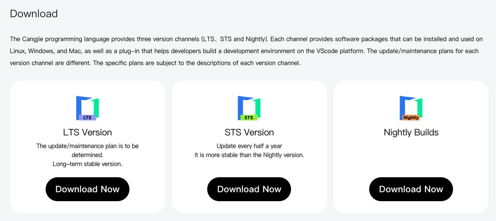
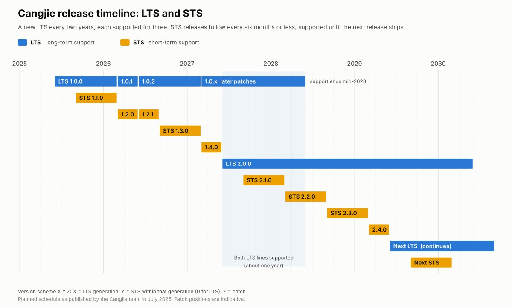

# Cangjie's First LTS Release: Three Years of Stable Support

Cangjie 1.0.0 is the language's first long-term support release, with three years of official maintenance and a compatibility guarantee for the whole window. For teams weighing a young language for production systems, this is the commitment that usually decides the question.

LTS vs. STS: Built for Different Jobs

Cangjie now ships on two tracks, with nightly builds as a third channel for those who want the bleeding edge.

LTS (Long-Term Support) is aimed at enterprise development and large engineering projects where stability matters more than new features. A new LTS ships every two years, and each one is maintained for three. That overlap gives teams roughly a year to migrate from one LTS generation to the next while both are still supported.

During the maintenance window, the Cangjie team commits to security vulnerability fixes (with fast response on high-severity issues), key functional improvements, and patches for core bugs. Updates within an LTS line stay strictly compatible, so applying a patch should never break your build.

STS (Short-Term Support) is for experimental projects, technical prototyping, and anyone who needs the newest language features now. Each STS builds on the latest LTS and adds new features and performance work, on a release cycle of six months or less. Support ends as soon as the next STS or LTS ships, so the team recommends STS only for short-lived projects or work that depends on the latest capabilities.

Patch Updates: Fixed Deadlines by Severity

Both LTS releases and any STS release still in maintenance receive patch releases, and each new patch supersedes the version it fixes. The release rules are tied to severity:

Vulnerabilities with a CVSS score above 7: 
patch released within 30 days, applied to every version in maintenance.

Vulnerabilities scoring below 7, or functional bugs: 
patch released within 90 days, applied to every version in maintenance.

Version Numbering

Cangjie uses an X.Y.Z scheme that tells you the support track at a glance.

X is the LTS generation. 
It increments with each new LTS, so the first is 1.0.0 and the next will be 2.0.0.

Y is the STS sequence within a generation. 
The first STS after 1.0.0 is 1.1.0, the next is 1.2.0. An LTS release always has Y = 0.

Z is the patch number, for both tracks. 
The first patch to 1.0.0 is 1.0.1; the first patch to 1.1.0 is 1.1.1.

In practice: a zero in the middle position means you are on LTS.

Upgrade Recommendations

The team advises tracking official security patches and important updates, and validating every upgrade in a test environment before it reaches production. For major version upgrades, the official technical team offers migration guidance on request.

Getting Help

Community forum:
[https://gitcode.com/Cangjie](https://gitcode.com/Cangjie), hosted on GitCode, a Chinese open-source code hosting platform.

Issue tracker:
[https://gitcode.com/org/Cangjie/issues](https://gitcode.com/org/Cangjie/issues). Include a detailed description and your version number.

Email:
Cangjie@huawei.com for technical support.

Most of a language's early releases are about what it can do. This one is about what happens to code written in it three years from now, stated with dates and severity thresholds that teams can hold the project to.
