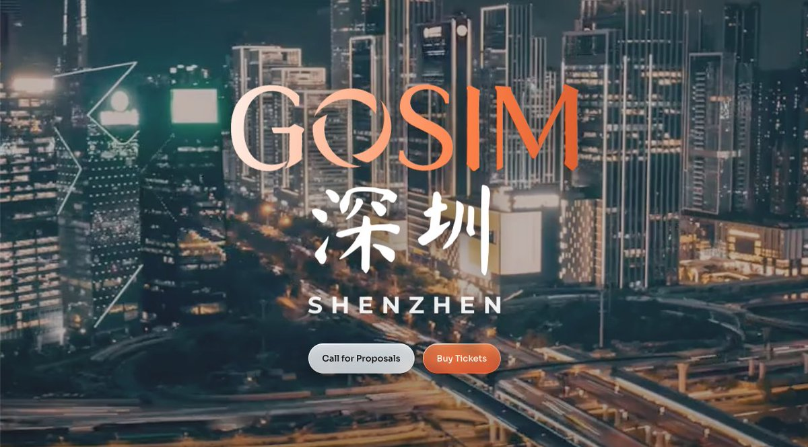

# Cangjie at GOSIM Shenzhen 2026: Three Talks on Agentic Engineering

AI agents can already write code. The harder problem is getting them to build what was actually asked for, to a standard a team can sign off on.

That question runs through all three talks the Cangjie team is bringing to GOSIM Shenzhen 2026, held October 16 to 17 at the ADEN Hotel Shenzhen Nanshan. GOSIM is a global open-source conference series, and the Shenzhen edition brings together 150+ international speakers and 2,000+ developers for keynotes, technical forums, workshops, hackathons and live project demos.

All times below are China Standard Time (UTC+8).

## Agent-Centric Engineering: From Personal Productivity to Organizational Capability

Sean Dong, Director of Programming Languages and IDE Projects, 2012 Laboratories (Huawei's central research arm)

**October 16, 11:05 to 11:30**

**Agentic AI Summit (3F, ADEN 1)**

Many developers now get real speed-ups from AI on their own. Sean's talk asks how that becomes something a whole organization can rely on. He will introduce Agent-Centric Engineering (ACE), in which people set the goals, quality boundaries and acceptance criteria, and agents carry out the engineering work. The talk covers ACEHarness, an open-source platform for spec-driven development and multi-agent collaboration, along with hands-on cases in compiler optimization and hash library performance tuning.

Session link: [https://shenzhen2026.gosim.org/schedule/p-56-agent-centric-engineering-from-personal-productivity-to-organizational-capability/](https://shenzhen2026.gosim.org/schedule/p-56-agent-centric-engineering-from-personal-productivity-to-organizational-capability/)

## Cangjie and the New Frontier of Programming Languages in the AI Era

Bohua Zhan, Technical Expert, Programming Language Lab, 2012 Laboratories, Huawei; PhD in Mathematics, Princeton University

**October 17, 15:30 to 16:00**

**Agentic AI Summit (3F, ADEN 1)**

Software is entering a stage where CPUs and large models execute work together. Bohua will look at what that means for a programming language that has to serve both human developers and AI agents. He will walk through Cangjie's AI-oriented compiler, LSP and testing infrastructure, a structured skills library, Speclang (a verifiable specification language), and early exploration of a language designed for agents.

Session link: [https://shenzhen2026.gosim.org/schedule/p-107-cangjie-and-the-new-frontier-of-programming-languages-in-the-ai-era/](https://shenzhen2026.gosim.org/schedule/p-107-cangjie-and-the-new-frontier-of-programming-languages-in-the-ai-era/)

## SpecArtisans: A Verifiable Spec-Driven Development Paradigm for AI Coding

Zixi Liu, Senior Engineer, Huawei; PhD, Nanjing University

**October 16, 14:35 to 15:10**

**Agentic OS & App (2F, HAI XIA 2)**

How do you keep an AI faithful to the original requirements at every stage of development? SpecArtisans places structured, verifiable software specifications between natural-language requirements and code, so the requirements carry through design, implementation and testing and can be checked at each step. The goal is to move AI coding from generating code to building software on requirements that are explicit, traceable and verifiable.

Session link: [https://shenzhen2026.gosim.org/schedule/p-58-specartisans-a-verifiable-spec-driven-development-paradigm-for-ai-coding/](https://shenzhen2026.gosim.org/schedule/p-58-specartisans-a-verifiable-spec-driven-development-paradigm-for-ai-coding/)

## Method, paradigm, language

Read together, the three talks cover the full chain: how a team organizes agent work, how requirements survive the trip from a sentence to running code, and what the language underneath needs to provide for both.

If you are at GOSIM Shenzhen, come find us.

Full schedule: [https://shenzhen2026.gosim.org/schedule/](https://shenzhen2026.gosim.org/schedule/)
