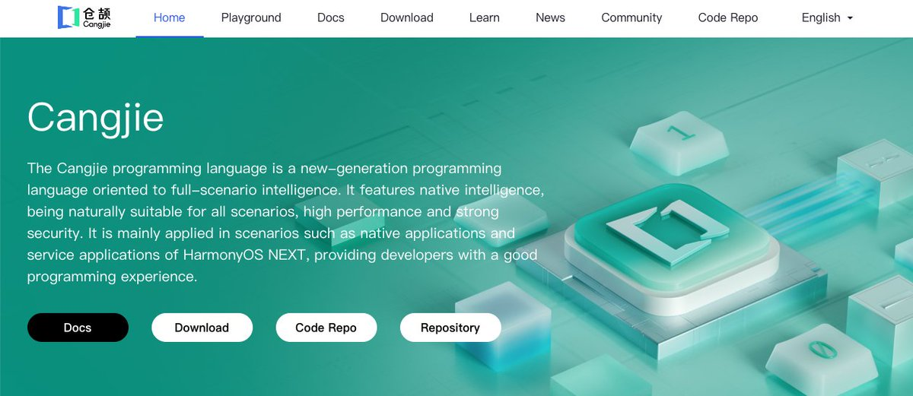
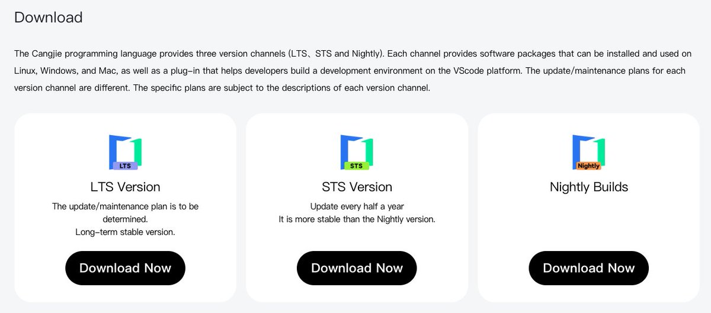
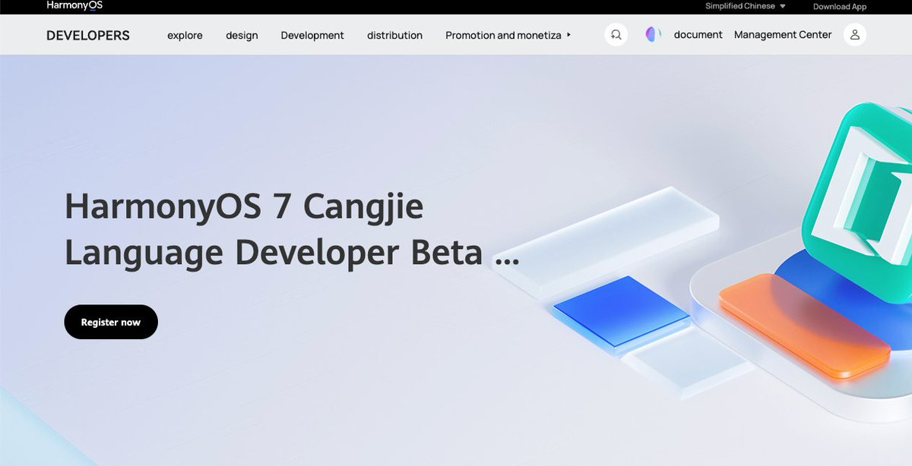

# Cangjie Official Resources, October 2026: Everything in One Place

Cangjie went open source in July 2025. Fifteen months later it ships on three release channels, cross-compiles to Android and iOS, and has its own package registry alongside more than 200 open-source third-party libraries.

Here is the October 2026 map of where everything lives.

Quick links

Official site: [https://cangjie-lang.cn/en](https://cangjie-lang.cn/en)

HarmonyOS developer portal: [https://developer.huawei.com/consumer/cn/cangjie](https://developer.huawei.com/consumer/cn/cangjie) 

Community on AtomGit, an open-source code hosting platform: [https://atomgit.com/Cangjie](https://atomgit.com/Cangjie) 

Third-party libraries (Cangjie-TPC): [https://atomgit.com/Cangjie-TPC](https://atomgit.com/Cangjie-TPC) 

New: the Central Repository, the official package registry, live since 8 March 2026: [https://pkg.cangjie-lang.cn](https://pkg.cangjie-lang.cn) 

Updated: the HarmonyOS Programming Language White Paper 2.0.

The official website

Besides a browser playground, docs, learning resources, community entry points and an AI assistant, the site hosts three release channels, each with Linux, Windows and macOS packages plus a VS Code plugin.

LTS: 1.0.5, released 10 February 2026. 

STS: 1.2.0, the first of the 1.2 series, maintained for six months, with cross-platform, compiler and toolchain improvements. 

Nightly: 1.3.0-alpha, built daily from main. On Windows: scoop install cangjie-nightly.

Development tools

The VS Code plugin now supports the Central Repository, organization-name syntax, cross-platform common/specific syntax and one-click debugging. New this year: the HLE tool, which generates interop glue from ArkTS and C headers (ArkTS is HarmonyOS's primary app language), and a Cangjie plugin for Qoder, Alibaba's agentic coding platform, which packages 570+ official documents into six Agent Skills the agent loads on demand.

Source code

Compiler, runtime and standard library are open, with an SDK build guide, tests and a test framework. Start here: [https://atomgit.com/Cangjie/community/blob/main/contribute/contribution.md](https://atomgit.com/Cangjie/community/blob/main/contribute/contribution.md)

General-purpose edition

Targets Linux, Windows and macOS on arm64 and x86-64. Since 1.1.0 it also builds for Android 8 and above, and for iOS devices and the simulator. cjpm, the package manager, now publishes to and resolves dependencies from the Central Repository, with exact-version or range pinning.

HarmonyOS edition

The HarmonyOS toolchain is in a developer preview, open by application until 31 March 2027: [https://developer.huawei.com/consumer/cn/activityDetail/cangjie-beta/](https://developer.huawei.com/consumer/cn/activityDetail/cangjie-beta/)

It is already in pilot production use in apps on the HarmonyOS NEXT store, including the mobile banking app of ICBC, China's largest bank by assets, plus Qimao Free Novels, [JD.com](https://JD.com) mini programs, LeetCode, and the rider app of Meituan Crowdsourcing, one of China's largest gig delivery platforms. From 1.1.0 the runtime also supports HarmonyOS on arm32.

AI coding and the developer tools ecosystem

Cangjie Skills: three community sets of Agent Skills, for general development, HarmonyOS apps, and coding conventions. [https://atomgit.com/Cangjie-SIG/CangjieSkills](https://atomgit.com/Cangjie-SIG/CangjieSkills)

SpecArtisan: turns a requirement into a traceable, verifiable design contract before a coding agent writes anything, so drift between requirement and code can be located rather than discovered at integration.

Tai-e-Cangjie: the first general-purpose static analysis platform for Cangjie, released on 1 September 2026 by Nanjing University's Institute of Software. It runs control-flow, data-flow and pointer analysis on Cangjie's intermediate representation. [https://atomgit.com/Tai-e-Cangjie/Tai-e-Cangjie](https://atomgit.com/Tai-e-Cangjie/Tai-e-Cangjie)

Qoder plugin: see Development tools above.

CUI (Cangcui): a cross-platform, declarative desktop GUI framework written in Cangjie. [https://github.com/SunriseSummer/CangjieGUI](https://github.com/SunriseSummer/CangjieGUI)

Community

The monthly online Workshop is at session 48. This year also brought an innovation challenge, a Hackathon and a Cangjie track at the Huawei ICT Competition. Apps built with Cangjie and AI coding include TaskGenie, a full-stack Cangjie task manager, and a flight simulator from a young developer known as "the kid" that made it to HDC, Huawei's developer conference.

Third-party libraries

More than 200 libraries are open source, covering networking, databases, security, UI, media, microservices and message queues. Partners include SAIC Motor, China's largest automaker, and iSoftStone. Source lives in TPC, packages in the Central Repository. [https://atomgit.com/Cangjie-TPC/TPC-Resource](https://atomgit.com/Cangjie-TPC/TPC-Resource)

Community pick: http_lib, a full HTTP/1.x and HTTP/2 implementation built only on the standard library, at about 48,000 lines with 1,576 passing tests.

The newest entries on this list are rarely language features. They are a registry, an interop generator, a static analyzer and agent-ready documentation: the layer that decides whether a language gets used beyond its first adopters.
