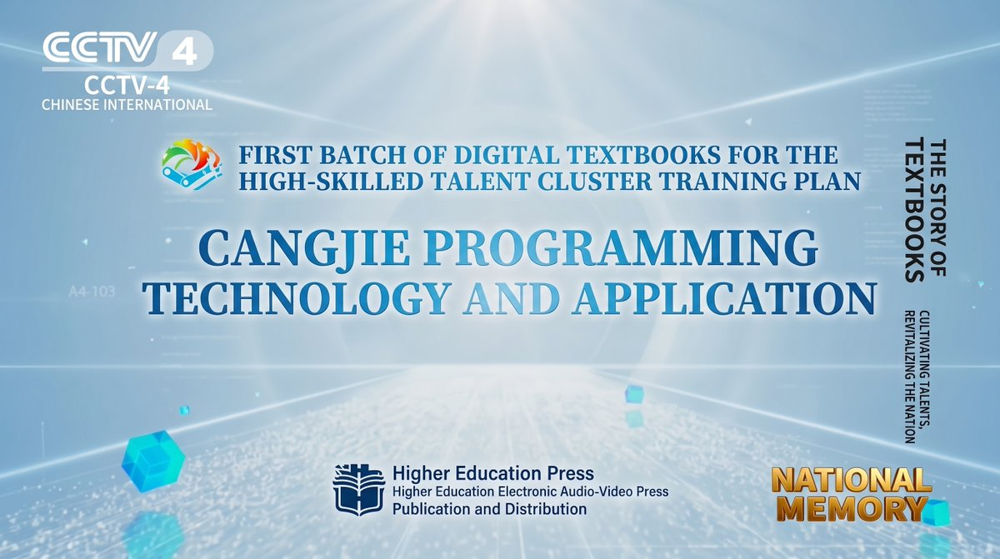
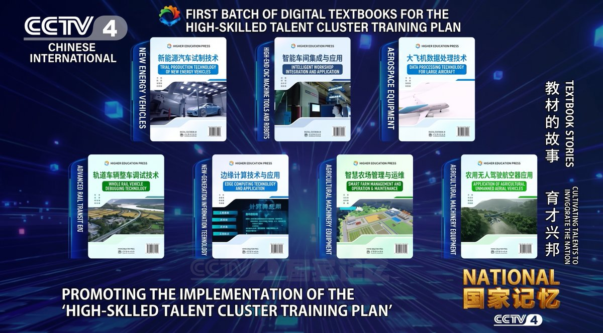

# Cangjie Textbook Among China's First National Digital Textbooks

The textbook for Cangjie was being written before the language was public.

While Cangjie was still in confidential internal testing, Huawei opened its developer guide and standard library APIs to a team of textbook authors. When the language entered public beta in October 2024, the digital textbook Cangjie Programming Technology and Applications was completed alongside it.

This month, on the eve of China's Teachers' Day, the textbook was featured in National Memory, a documentary series on CCTV-4. It was presented as one of the first digital textbooks selected for the High-Skilled Talent Cluster Training Programme, a national initiative for training advanced technical workers.

## 01 Beyond Chips

In the documentary, He Jianbiao, Vice Dean of the School of Undergraduate Education at Shenzhen Polytechnic University, made a point that is easy to overlook. Chips and integrated circuits are only part of the picture. Above the hardware sits a layer of foundational software, and programming languages are one of its most important components.

Hardware tends to dominate the conversation: lithography machines, process nodes, fabrication plants. Operating systems, databases, middleware and languages get less attention, but they determine what developers can build and how quickly.

The documentary made the practical case as well. Once Huawei's phones, PCs and tablets moved to HarmonyOS, the platform needed native applications, and it needed developers who could write them. Training those developers became an immediate requirement rather than a long-term goal.

## 02 What Cangjie Is

The documentary describes Cangjie as a new-generation programming language for all-scenario intelligent applications, used mainly for HarmonyOS native apps and services. It was built for a specific ecosystem with real demand behind it, not as a research exercise.

## 03 Textbook and Industry in Sync

The most striking detail in the documentary is the timing.

During confidential internal testing: the developer guide and standard library APIs were shared with the textbook team, and the university and industry partners began writing.

October 2024: Cangjie opened its public beta, and the digital textbook was completed at the same time.

September 2026: the textbook was featured on National Memory and named among the programme's first digital textbooks.

According to the documentary, both sides had reasons to start early. The university needed teaching material that matched the language students would actually use. The industry side needed trained developers as soon as the platform opened.

Textbooks usually follow a technology by a year or more, once it has stabilised. Here the material was ready when the language shipped.

## 04 What Kind of Textbook

Publisher: Higher Education Press, China's largest academic publisher, together with its electronic and audiovisual imprint.

Format: an interactive digital textbook organised around the core tasks of a working Cangjie developer, rather than a printed book.

AI assistance: an embedded AI agent. Students describe what they need, and the agent helps them generate a code design.

Iteration: eighteen months of revision, with the content updated to track each industry release of the language.

Teaching value: it reduces the ongoing one-to-one guidance a teacher has to give on programming exercises, often the most time-consuming part of running a programming course.

## 05 Strategy and Model

The documentary credited the textbook on two counts. First, it fits national priorities for developing a domestic foundational software industry. Second, it demonstrated a new way of producing textbooks, with a clear division of labour between school and company, which the documentary offered as a reference for other vocational digital textbooks.

The second point has the wider relevance. Any new language faces the same problem: universities wait for it to mature before teaching it, and it struggles to mature without trained developers. Starting the textbook during internal testing is one way to break that loop.

The first students to learn Cangjie from a textbook learned the version that was actually shipping. That happened only because the writing began while the language was still confidential.
