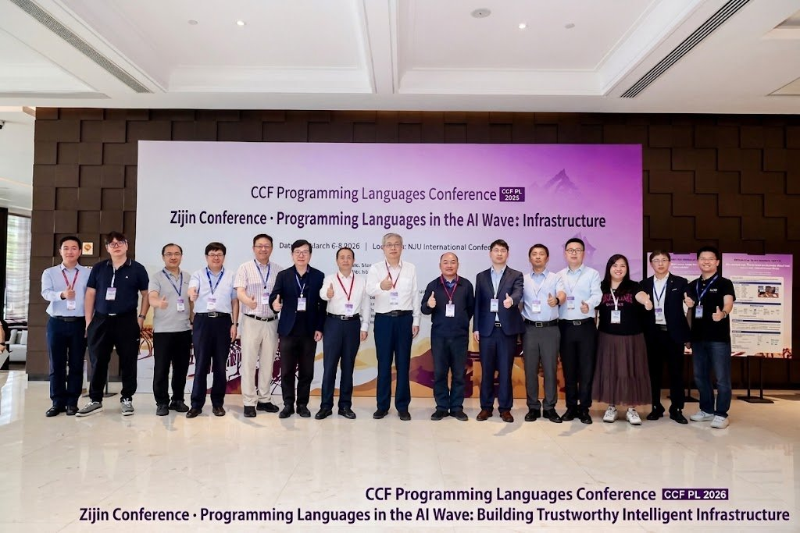
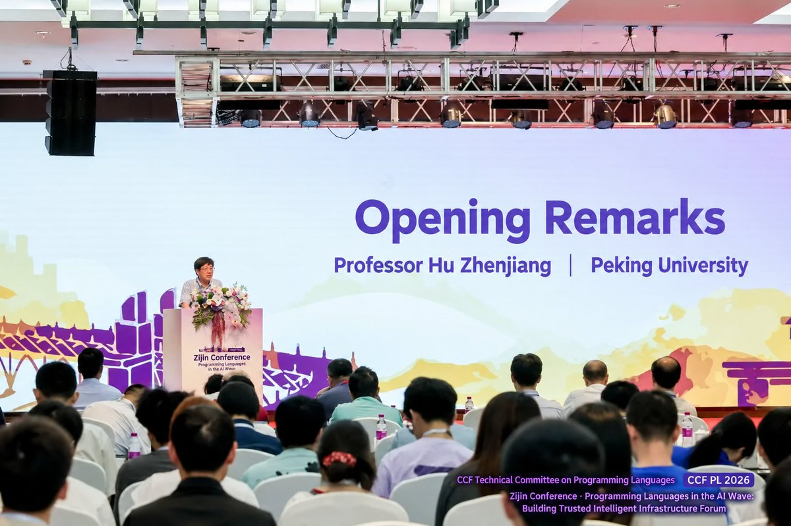
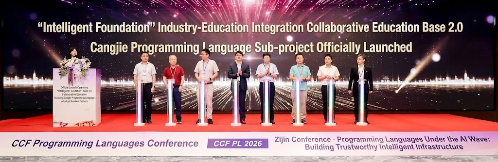
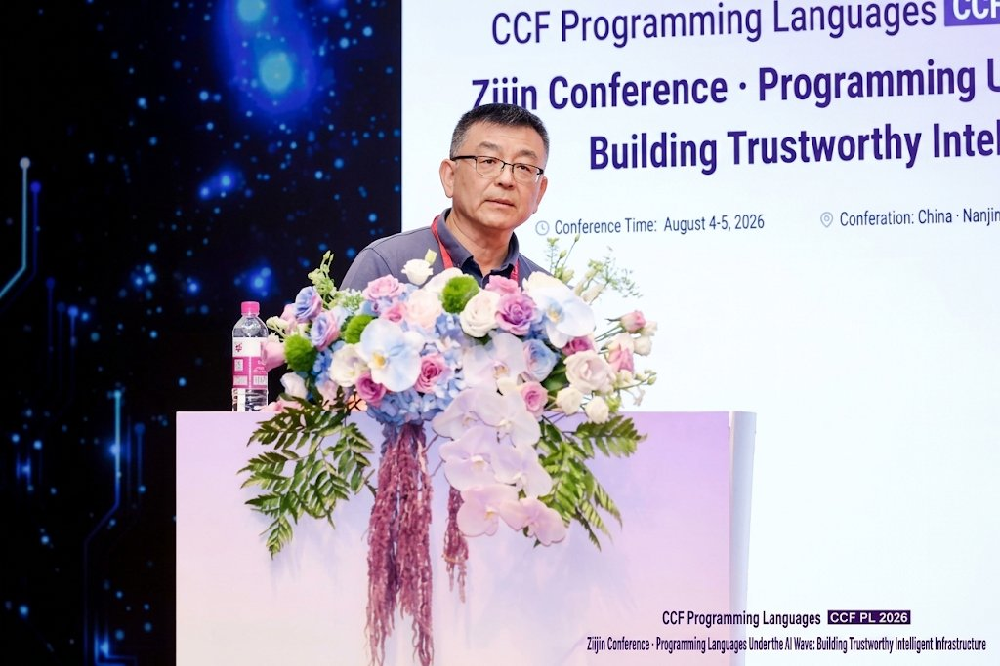
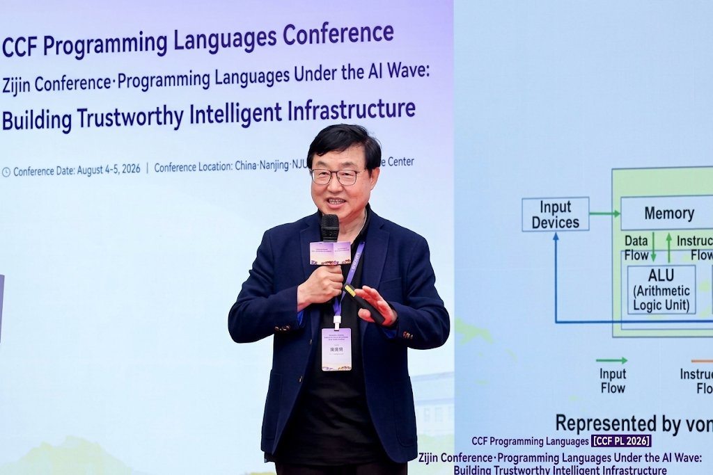
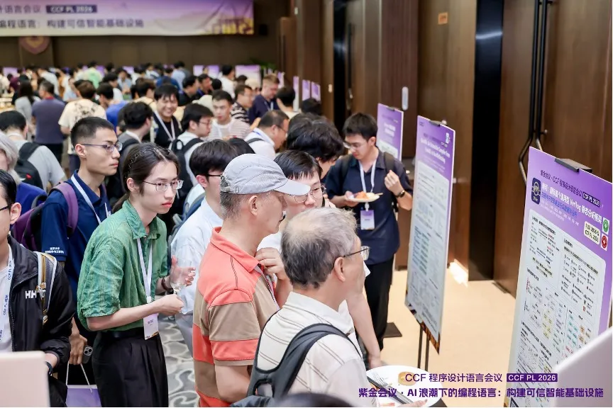

# CCF PL 2026: What a Language Must Guarantee When AI Writes the Code

Asked whether natural language will replace programming languages, a panel of six senior Chinese PL researchers said no. The reasoning is the part worth reading.

Their position: the two are heading for a division of labour, not a succession. The parts of a program that must be exact stay in formal language. The parts tightly bound to a specific application get expressed in natural language. Ambiguity remains the reason natural language cannot carry precise program specification on its own, and that problem does not get solved by better models. And when a model generates code, it should be generating the evidence needed to check that code alongside it, with a layered audit mechanism sitting on top.

That exchange opened CCF PL 2026, held on August 4 and 5 at Nanjing University's Xianlin campus. It was the first edition of a new programming languages conference run by CCF, China's main computing professional body, initiated by Hu Zhenjiang of Peking University and Feng Xinyu of Nanjing University. Around 200 researchers and industry engineers attended, under the theme "Programming Languages in the AI Wave: Building Trustworthy Intelligent Infrastructure". Opening remarks came from Hu Zhenjiang, Lü Jian of Nanjing University, and Huang Jianhui, who directs Huawei's Compiler and Programming Language Lab.

## The roundtable: what a language has to guarantee when a model writes the code

Hu Zhenjiang moderated, with panellists from Peking University, Nanjing University, the National University of Defense Technology, and Huawei.

Beyond the split above, one framing recurred: the AI era may produce genuinely new language elements, and PL research should be reasoning about this on the timescale of language evolution rather than product cycles. Treating natural language and programming languages as competitors is the wrong model.

Where the panel converged: the future language is an organic combination of intent expressed in natural language and execution made precise by formal means. The open question is which new language mechanisms and verification techniques make AI-generated software safe, checkable, and able to evolve.

## Two launches

The conference launched the Cangjie sub-project under "Intelligent Base" 2.0, a Ministry of Education and Huawei programme that puts domestic core technologies into university curricula. The sub-project covers course development, teaching practice, and student training around Cangjie, Huawei's programming language. Eight universities took part in the launch alongside Huawei.

Curriculum adoption is a more expensive signal than it looks. A lecturer has to rewrite lab materials, retrain themselves, and stake a semester of student outcomes on a language that is still young.

The 2026 Cangjie Cup programming competition launched at the same session, built around agents and intelligent software engineering: students take a real problem through requirements analysis, system design, implementation, verification, and deployment, and are judged on working engineering output.

## Jingling Xue: the easier code generation gets, the more the compiler matters

Xue, an IEEE Fellow at UNSW Sydney whose group built the SVF static analysis framework now used at more than 250 universities and companies, used fully homomorphic encryption compilation as the concrete case.

His argument: as AI widens the space of candidate implementations and optimizations, a language system can no longer express only computational semantics. It has to express user intent, numerical semantics, security constraints, and resource targets as machine-checkable information, then preserve or refine those constraints through compilation, checking, execution, and later evolution.

ANT-ACE is the worked example. Multi-level IR, legality analysis, optimization and search take a high-level specification down to legal and efficient implementations for different execution targets. The interesting property is that different users enter at different abstraction levels: application developers at model and business semantics, FHE specialists at packing, rotation, and scale, hardware specialists at kernel, memory, and target mapping. All three entry points share one specification-driven compilation infrastructure.

The general principles he drew out: keep high-level intent, state key semantics and constraints explicitly, define what counts as an acceptable implementation in machine-checkable form, preserve or refine the contract during lowering, and let the system keep evolving. In other words, be explicit about what must hold, what may change, and what implementation you are willing to accept.

## Gao Yaoqing: the Agentic Compiler

Gao, chief expert at Huawei's Compiler and Programming Language Lab, named four problems blocking AI-native development: heterogeneous compute fragmenting the programming ecosystem, probabilistic generation producing semantic hallucination and logic defects, cross-architecture performance tuning still depending on expert intuition, and AI agents sitting apart from the traditional toolchain.

Huawei's answer is a five-way integration of language, framework, compiler, IDE, and agent, with the compiler as the deterministic backstop for what the model generates. The Agentic Compiler is the engine: the agent runs across compilation planning, reflection, generation, and self-iteration, and a layered unified IR carries computational semantics together with agent state, memory, and tool-call semantics, so there is no format gap between the agent and the compiler's middle end.

Concretely, that means L0 to L4 cross-layer end-to-end optimization covering load, communication, and power together, a complete record of agent decisions with IR version rollback for postmortems, and a two-way loop between compile-time static analysis and runtime dynamic optimization, with formal verification used as the defence against generated defects.

## Breadth

Researchers from CUHK, Nanjing University, Peking University, Shanghai Jiao Tong University, and Zhejiang University presented on compiler analysis and backend correctness, floating point optimization, formal verification toolchains for Rust and C, static analysis and vulnerability detection, program synthesis, type systems, LLM-assisted development and verification, quantum and temporal program verification, symbolic execution, and constraint solving. An industry forum brought engineering practice from Huawei, NetEase, and Shenzhen Kaihong, a commercial OpenHarmony vendor. A poster session ran over dinner on the first evening.

Until now, PL researchers in China have largely met each other at PLDI and POPL, which means overseas. A domestic venue does not change what the community produces, but it changes the cadence of the conversation, and it makes the industry side of the room much easier to fill.

The thing to watch is the second edition. The roundtable reached broad agreement that generated code should ship with checkable evidence, and both keynotes described specification-driven compilation as the way to get there. Whether that shows up next year as running systems or as the same slides is the actual test.
