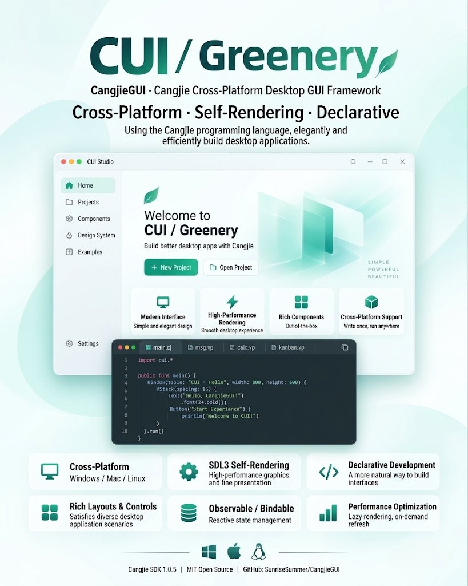
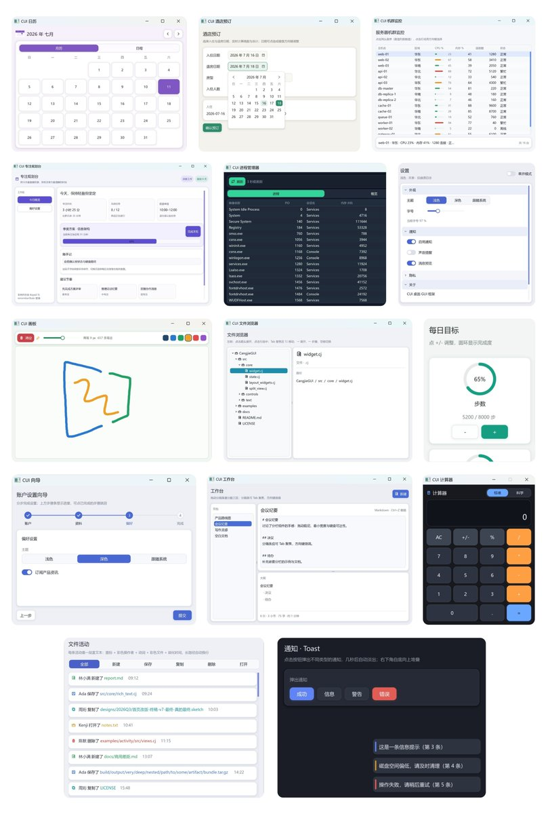

# CUI: SwiftUI-Style Desktop Apps, Written in Cangjie

Desktop GUI is one of the thinner corners of the Cangjie ecosystem. CUI, a framework from a community developer, fills it with a declarative API that feels close to writing SwiftUI, and it runs on Windows, macOS and Linux.



What it is

CUI is a desktop GUI framework written in the Cangjie programming language. Its Chinese name, Cangcui (苍翠), means "lush green" and echoes the first syllable of Cangjie. The project describes itself in three words: cross-platform, self-rendering, declarative. Its stated goal is to let developers build desktop creative software in Cangjie cleanly and efficiently.

Self-rendering means CUI does not wrap the operating system's native widgets. It draws the entire interface itself inside the window, on top of Cangjie bindings for SDL, the long-established cross-platform graphics library widely used in games. The payoff is a UI that looks the same on every platform, tight control over rendering, and room to build a distinctive visual style. The cost is that your app ships its own graphics runtime, covered under deployment below.


Core capabilities

1. Declarative UI: the interface is described as nested structures, so the code is the layout.
1. Reactive state: built-in primitives such as State update the UI automatically when data changes.
1. Common components: window, text label, button, panel, and layout containers such as VStack, ready to use.
1. Graphics and images: drawing and image support come from the SDL layer underneath.
1. System integration: apps can call platform-specific capabilities, extending what desktop software built on CUI can do.

Getting started

Requirements are minimal: Cangjie SDK 1.0.5 on Windows, macOS or Linux. Add the dependency to cjpm.toml:

```cangjie
[dependencies]
cui = { path = "<path/to/CangjieGUI>" }
```

An interactive window then takes about fifteen lines:

```cangjie
import cui.*

main() {
    let message = State<String>("Hello, CUI")
    let app = DesktopApp(WindowSpec("CUI Demo", 640, 420))
    app.run {
        VStack {
            Panel {
                Label(message.value)
            }.flexible(false)
            Button("Update text", { => message.value = "State updated" })
                .role(ButtonRole.Primary)
                .width(160.vp)
        }.spacing(12.vp).padding(20.vp)
    }
}
```

Run cjpm run and a window appears with a vertical layout: a label showing the current message and a button that changes it. The button's closure writes to message.value, and because message is a State, the label updates with no manual refresh. That combination of declarative structure and state binding is where the SwiftUI comparison comes from.

Example gallery

The repository includes ten example apps that show the framework's range. The standout is cangcui, a landscape scroll painted in the blue-green tradition of classical Chinese art, a good demonstration of what self-rendering allows beyond standard widgets. The other nine cover everyday desktop patterns: a calculator, a calendar, a notepad, a product kanban board, a command palette, a master-detail notes app, a data table, a contacts CRM, and a split-pane workbench.



Deployment tip

When you distribute a CUI app, the SDL, SDL_ttf and SDL_image dynamic libraries need to sit in the same directory as the Cangjie executable, or on the target platform's library search path. You can bundle them privately with your app, or install them on the target machine as a shared runtime.

Learning resources

- User guide: organized by concepts, tasks and complete tutorials.
- API reference: signatures, default values and behavioral edge cases.
- Example apps: complete projects in the repository's examples directory, runnable and paired with exercises.

Final thoughts

CUI brings the modern pairing of declarative UI and reactive state to Cangjie, and uses SDL to render consistently across platforms. If you are building desktop tools or small creative software in Cangjie, it deserves a place on the shortlist. The project is MIT licensed, so forking and experimenting are fair game.

[github.com/SunriseSummer/CangjieGUI](https://github.com/SunriseSummer/CangjieGUI)
