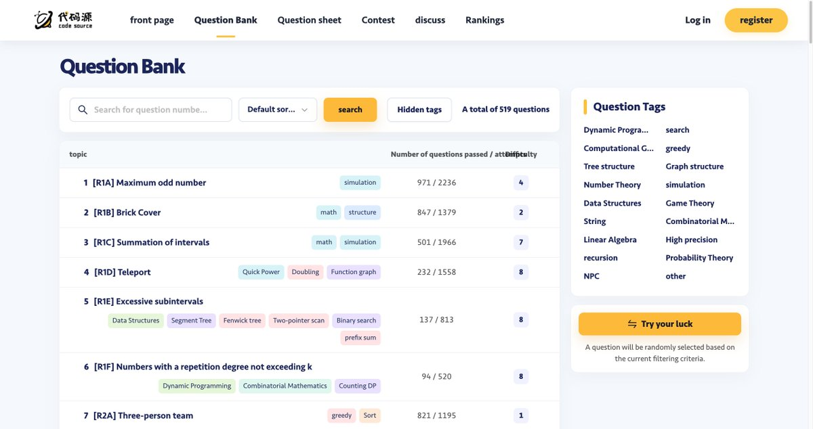
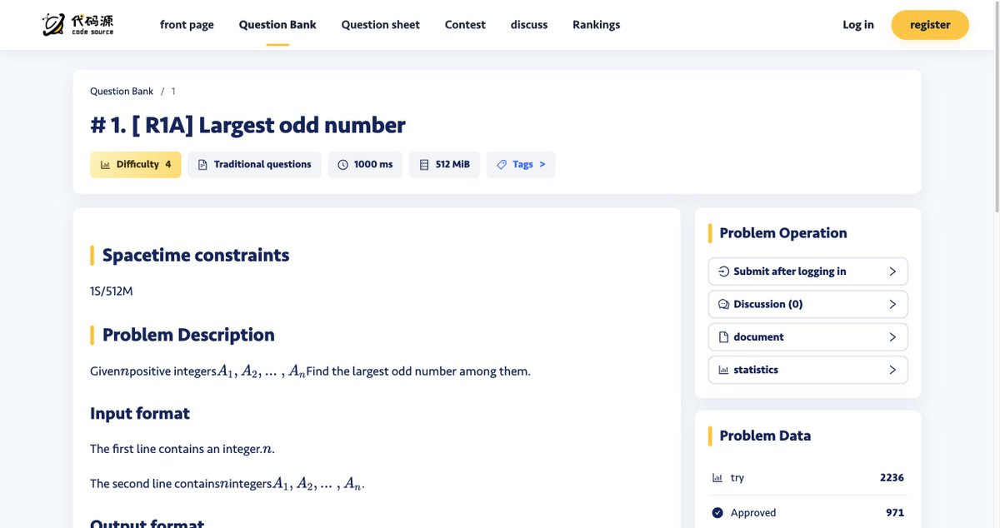
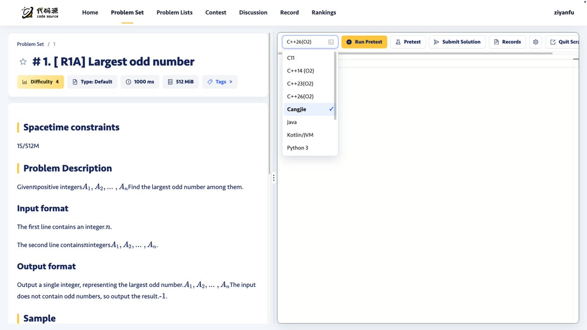

# Daimayuan OJ Adds Cangjie: 491 Problems with Real-Time Judging

Cangjie now runs on a competitive programming judge. Daimayuan OJ has added Cangjie as a submission language across all of its challenge contests and practice problems, with no application or sign-up step required.

Daimayuan OJ ([https://bs.daimayuan.top/](https://bs.daimayuan.top/)) is an online judge built for algorithm contests, programming teaching and everyday practice. Its problem bank holds 491 problems, and every submission is judged in real time against hidden test cases.

What you can do there

Practice: problems cover language basics, data structures and dedicated algorithm topics, across a range of difficulty levels and problem types.

Enter challenge contests: timed rounds that follow real contest pacing, with live rankings so you can see where you actually stand.

Review and improve: every weekly challenge is followed by published editorials that explain the intended approach and point to better solutions.

Who it's for

The contest series is aimed at people who already know the basics and are preparing for something specific: CSP-J/S, the national programming certification for school students run by the China Computer Federation (CCF); university contests such as ICPC and its Chinese counterpart CCPC; or coding tests and interviews at major tech companies.

How to submit in Cangjie

**Step 1: Open the platform and go to the problem bank.**

Step 2: Open any problem and switch to online coding mod

**Step 3: Select Cangjie from the language menu.**

**Step 4: Write your solution, submit it, and check the judging result.**

The announcement walks through an introductory problem: choose three people from a list to maximise the team's combined skill score. The Cangjie solution, about 25 lines reading from standard input, passed all ten test cases, each in 6 ms or less, with peak memory at 3 MiB.

A practice ground for the Huawei ICT Competition

The Huawei ICT Competition, Huawei's annual technology contest for university students, now includes a Cangjie programming track. It tests the Cangjie development environment, language fundamentals, use of third-party libraries and application development. For anyone preparing for that track, Daimayuan OJ offers a place to practise under contest conditions.

What's next

The Daimayuan team plans to keep the platform in step with new Cangjie releases and toolchain updates, and to keep improving compilation, judging and submission. Problem contributions and suggestions are welcome.
