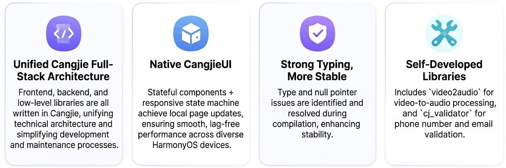
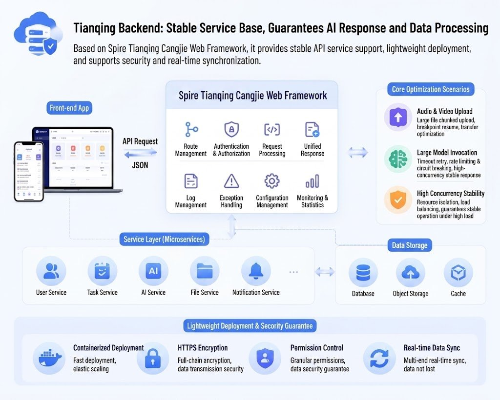

# Full-Stack Cangjie in Production: AI Task Manager TaskGenie Is Now Live

TaskGenie is now live on the HarmonyOS app market. Frontend, backend, AI layer, and the underlying utility libraries are all written in Cangjie.

The app itself is straightforward: feed it a photo of a whiteboard, a meeting recording, or a wall of chat messages, and it extracts the tasks, classifies them, and builds a plan. What makes it worth a closer look is that it works as a proof point for something the Cangjie ecosystem has been claiming and not often demonstrating end to end, which is that you can build a complete production application without leaving the language.

Built by Makerizon Studio, TaskGenie runs on three pieces: Cangjie itself, the CangjieMagic agent framework, and the Spire web framework.

## Frontend: One Language, One Type System

The entire UI is built with CangjieUI, using declarative components and reactive state management for partial page updates. It runs across phones and tablets on HarmonyOS.

The more interesting consequence of a single-language stack is on the type system side. Because frontend and backend share the same data structures, type mismatches and null pointer issues get caught at compile time rather than surfacing as runtime errors at the API boundary. This is the kind of benefit that is easy to state and hard to actually get in a polyglot stack, where the contract between services is usually enforced by convention and testing rather than by the compiler.

The team also built and shipped two of their own Cangjie third-party libraries for this project: `video2audio` for extracting audio from video, and `cj_validator` for phone number and email input validation.

## AI Layer: CangjieMagic

TaskGenie's AI capabilities are built on CangjieMagic, an annotation-based agent framework, covering three input paths.

Image OCR handles uploaded whiteboard photos and screenshots, extracting text and generating standardised tasks with categories and deadlines. Text extraction takes transcribed recordings or long chat threads and parses them into a task list. The conversational breakdown assistant handles complex plans through multi-turn interaction, producing steps concrete enough to actually execute.

## Backend: Spire

The backend runs on the Spire Cangjie web framework, providing API services for both frontend interaction and AI processing. The team optimised transport and exception handling specifically for audio and video upload and large model invocation, the two paths most likely to fail under load. The architecture is lightweight enough for simple deployment while supporting real-time sync across devices.

## What the Project Demonstrates

The full loop runs from multi-format input, through AI structuring, into kanban-style organisation, with a Pomodoro timer inside each task and data retained for review. Meeting notes, study plans, project coordination all fit the same shape.

But the real result here is the stack itself. TaskGenie is a complete production application, published to a public app market, with every layer built in Cangjie: UI, AI logic, backend services, and utility libraries. For a language still building out its ecosystem, a shipped app that never leaves the language is a more convincing argument than any benchmark.

Makerizon plans to continue iterating on the app and will open-source the code for their in-house third-party libraries.

TaskGenie is available now on the HarmonyOS app market.

