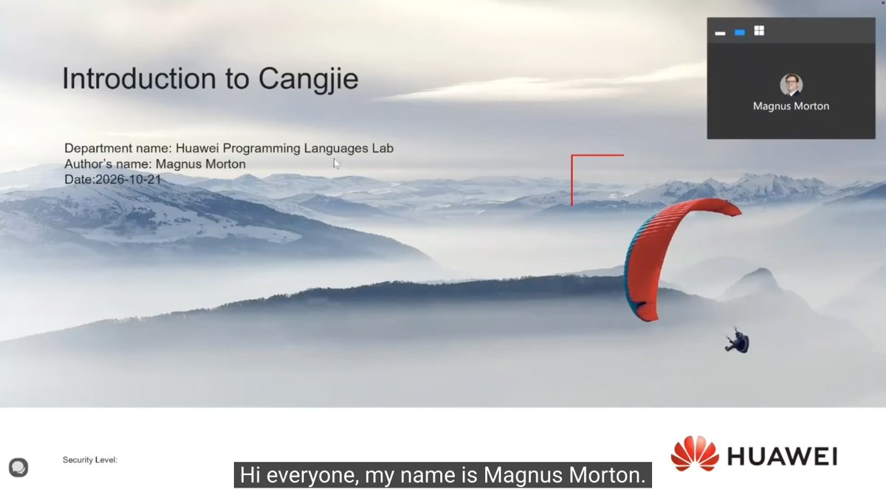
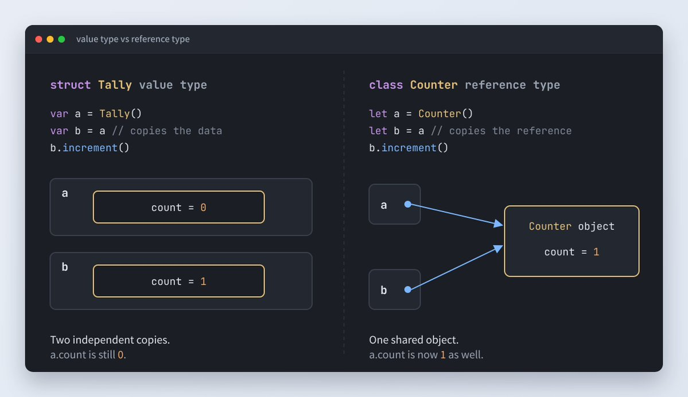
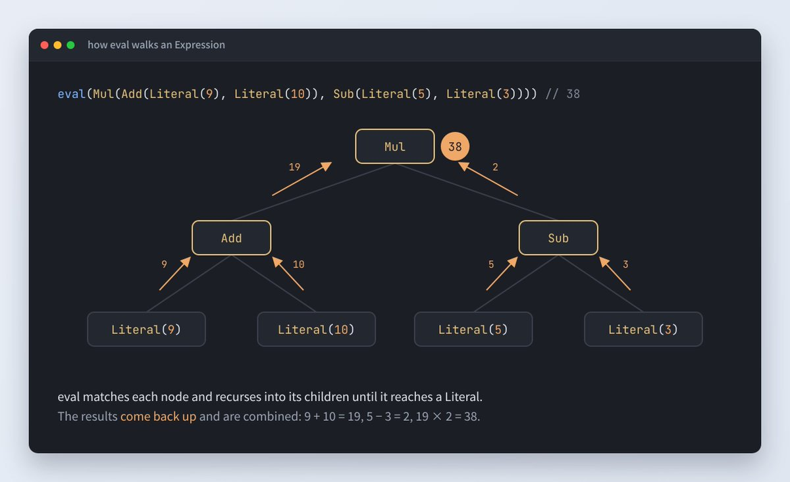
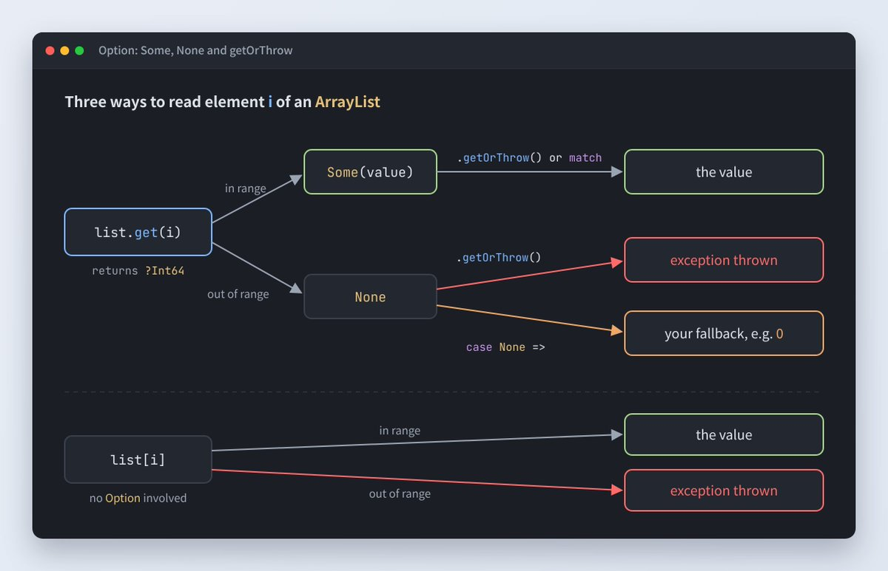
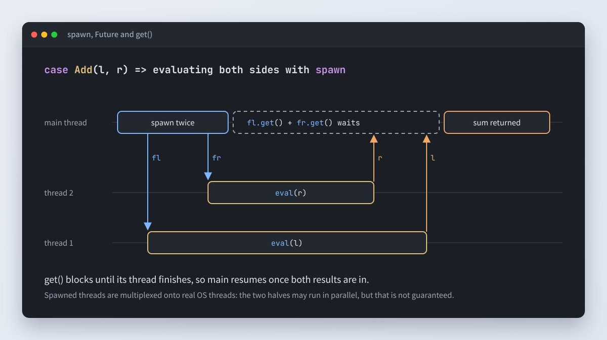

# Getting Started with Cangjie: Hello World to Concurrency

The Cangjie Track of the Huawei ICT Competition 2026–2027 asks students to solve open-ended problems in a language most of them have never written. In the second online enablement session, Magnus Morton of Huawei's Programming Languages Lab spent half an hour on what they need to get started.

Morton holds a PhD in Computing Science from the University of Glasgow and works on the design of effect handlers in Cangjie. His tour skipped the theory and stayed on the parts of the language a newcomer meets first. This write-up follows the same path, with the code from his slides so you can try each step yourself.



## 1. Getting set up

Everything starts at [https://cangjie-lang.cn/en](https://cangjie-lang.cn/en), available in English and Chinese. The main package installs cjc, the compiler, and the site hosts the user manual, the standard library API reference and a tools guide. A VS Code plugin is also available.

Hello world looks familiar: curly braces, println and full Unicode support in strings. The one surprise is main, which is the program's entry point and is written without the func keyword. A single file compiles with cjc. For anything bigger, Morton recommended cjpm, Cangjie's package manager, which plays the role Cargo plays for Rust.

```
main() {
    println("hello world! 您好")
}
```

```bash
$ cjc -o hello hello.cj      # compile a single file
$ ./hello
hello world! 您好

$ cjpm init                  # scaffold a project with src/main.cj
$ cjpm run                   # build and run
$ cjpm test                  # run the tests
```

## 2. Default to let

Cangjie has three kinds of binding: let for values that are never reassigned, var for variables, and const for values computed at compile time. Reassigning a let binding is a compile error. Note that let fixes the binding, not the contents: you can still append to a list held in a let. Morton's advice was to use let unless you are sure you will need to reassign, because it stops you from doing bad things by accident.

The ${...} syntax inside a string is interpolation, and it accepts any Cangjie expression.

```
main() {
    let name = "Magnus"
    name = "Jim"                // Error: a let binding cannot be reassigned
    println("hello ${name}")
}
```

```
main() {
    var name = "Magnus"
    name = "Jim"                // OK: var can be reassigned
    println("hello ${name}")    // hello Jim
}
```

## 3. Loops

Loops iterate over ranges. 0..3 excludes the end and 0..=3 includes it, a difference Morton tripped over himself on stage. A loop can also carry a where clause that filters iterations, which Morton noted many developers will not have seen in other languages. The same for loop works over arrays and other collections, and plain while loops behave as you would expect.

```
main() {
    var acc = 0
    for (i in 0..3) {                       // 0, 1, 2: end excluded
        acc += i
    }
    println(acc)                            // 3

    for (i in 0..=3) {                      // 0, 1, 2, 3: end included
        print("${i} ")
    }
    println()

    for (i in 0..=3 where i % 2 == 0) {     // even values only
        print("${i} ")                      // 0 2
    }
    println()

    let words = ["This", "is", "Cangjie"]   // same for loop over a collection
    for (word in words) {
        print("${word} ")
    }
}
```

## 4. Functions and lambdas

Functions are declared with func, parameters as name: Type. The return type can be left out and inferred, or annotated after a colon. A function also returns its last expression without needing a return statement, so code with no explicit return may still be returning a value.

```
// Return type inferred, explicit return
func sum(n: Int64) {
    var acc = 0
    for (i in 0..n) {
        acc += i
    }
    return acc
}

// Return type annotated, the last expression is returned
func sumTyped(n: Int64): Int64 {
    var acc = 0
    for (i in 0..n) {
        acc += i
    }
    acc
}
```

Lambdas are written in braces with => between parameters and body. They can capture variables from the scope around them and can be passed to any function that expects a matching function type, written as (Int64) -> Int64.

```
// A function that takes a function of type (Int64) -> Int64
func applyTwice(f: (Int64) -> Int64, x: Int64): Int64 {
    f(f(x))
}

main() {
    let step = 10
    let addStep = { x: Int64 => x + step }   // a lambda that captures step
    println(applyTwice(addStep, 1))          // 21
}
```

## 5. Value types and reference types

This is the distinction Morton flagged as most likely to trip people up. Primitives, structs, tuples and VArrays are value types, copied when they are passed around. Arrays, classes and the standard library collections are reference types. A VArray's length is fixed at compile time, which matters mainly when calling C code. Tuples cannot be modified once created.

```
main() {
    let a: Array<Int64> = [1, 3, 2, 4]       // reference type
    let zeros = Array<Int64>(3, repeat: 0)   // [0, 0, 0]
    let v: VArray<Int64, $3> = [4, 5, 1]     // value type, length fixed at compile time

    var t = (true, false)
    println(t[0])                            // OK: tuple elements can be read
    t[0] = false                             // Error: tuple elements cannot be assigned
}
```

Classes and structs look almost identical, with two differences worth remembering. Structs are immutable by default, so a method that changes one must be marked mut, and structs can neither inherit nor be inherited from. Both can implement interfaces.

```
class Counter {
    public var count = 0
    public func increment() {
        count += 1
    }
}
```

```
struct Tally {
    public var count = 0
    public mut func increment() {    // mut is required to modify a struct
        count += 1
    }
}
```

Copy each one and the difference shows:



Classes support inheritance with <:, abstract classes and dynamic dispatch. The constructor written with the class name is the primary constructor: its let parameters become fields automatically, with no body needed. Morton said Cangjie code is moving towards using primary constructors.

```
import std.math.*

abstract class Shape <: ToString {
    public func area(): Float64
}

class Rectangle <: Shape {
    Rectangle(let h: Float64, let w: Float64) {}   // primary constructor
    init(side: Float64) { this(side, side) }       // a square

    public override func area(): Float64 { h * w }
    public func toString(): String {
        "a ${h} by ${w} rectangle"
    }
}

class Circle <: Shape {
    Circle(let r: Float64) {}

    public override func area(): Float64 { Float64.getPI() * r ** 2 }
    public func toString(): String {
        "a circle of radius ${r}"
    }
}

main() {
    let shapes: Array<Shape> = [Circle(2.0), Rectangle(3.0, 5.0)]
    for (shape in shapes) {                        // dynamic dispatch
        println("shape: ${shape} area: ${shape.area()}")
    }
}
```

## 6. Enums and pattern matching

Cangjie's enums are closer to algebraic data types than to the enums of C or C++: each case can carry data, and an enum can refer to itself. Paired with match, this is enough to write a small expression evaluator. Each case pulls the values it needs out of the enum, which Morton pointed out would be painful to write with plain if statements.

```
enum Expression {
    | Literal(Int64)
    | Add(Expression, Expression)
    | Sub(Expression, Expression)
    | Mul(Expression, Expression)
}

func eval(e: Expression): Int64 {
    match (e) {
        case Literal(i) => i
        case Add(l, r) => eval(l) + eval(r)
        case Sub(l, r) => eval(l) - eval(r)
        case Mul(l, r) => eval(l) * eval(r)
    }
}

main() {
    let expr = Add(Literal(9), Literal(10))
    println(eval(expr))                     // 19
}
```

Nest the cases one level deeper and you can see the recursion at work:



## 7. Option, the most important enum

The enum Morton called the most important is Option, which the standard library uses heavily. A function that can fail, such as ArrayList's get, returns ?T, short for Option<T>: either Some value or None. Call getOrThrow when an exception is acceptable, or match on the result to handle the failure case yourself. Indexing with list[i] skips the Option and throws if the index is out of range.

```
import std.collection.*

main() {
    let list = ArrayList<Int64>(10)       // initial capacity 10
    list.add(all: [1, 2, 3])              // [1, 2, 3]
    list[1] = 120                         // [1, 120, 3]
    list.add(99)                          // [1, 120, 3, 99]

    // get returns ?T, short for Option<T>
    let b = list.get(2).getOrThrow()      // 3, or an exception if out of range

    let c = match (list.get(10)) {        // or handle both cases yourself
        case Some(num) => num
        case None => 0
    }
    println("${b} ${c}")                  // 3 0
}
```

Side by side, the three ways of reading an element behave like this:



## 8. Lightweight concurrency

The spawn keyword runs a computation on a lightweight thread and returns a Future, and calling get on it waits for the result. Unlike lightweight threads in some other languages, these are multiplexed onto real OS threads, so true parallelism is possible, though not guaranteed. Morton reused the evaluator to show it: spawn each side of an Add and wait for both. In a toy example the gain is small, but spawning is cheap, which makes it a good fit for work that waits on I/O.

```
main() {
    let fut: Future<Unit> = spawn {
        println("hello from another thread")
    }
    fut.get()    // wait for the thread to finish
}
```

```
func eval(e: Expression): Int64 {
    match (e) {
        case Literal(i) => i
        case Add(l, r) =>
            let fl = spawn { eval(l) }
            let fr = spawn { eval(r) }
            fl.get() + fr.get()
        case Sub(l, r) => eval(l) - eval(r)
        case Mul(l, r) => eval(l) * eval(r)
    }
}
```



## 9. Beyond the basics

Morton closed with features competitors are less likely to need early on: macros that generate Cangjie code at compile time, effect handlers (still experimental), actors provided as a library, a C foreign function interface, and Cangjie Magic, a separate AI agent framework. 

His closing advice was the simplest point of the session: when you get stuck, go back to [[cangjie-lang.c](https://cangjie-lang.cn)n](https://cangjie-lang.cn/en). By his account, the user manual covers literally everything in the language. For a hands-on companion, the [step-by-step tutorial](https://cjpluk.github.io/learn/) walks through the same topics with runnable examples.

**The full session is on YouTube:**

[https://youtu.be/yBYcZ1dQoz8](https://youtu.be/yBYcZ1dQoz8)

**Registration for the Cangjie Track is open across the Asia-Pacific region:**

[[https://e.huawei.com/en/talent/#/ict/innovation-details?zoneCode=050133&zoneId=98269685&compId=85132020&divisionName=Asia%20Pacifi](https://e.huawei.com/en/talent/#/ict/innovation-details?zoneCode=050133&zoneId=98269685&compId=85132020&divisionName=Asia%20Pacific)c](https://e.huawei.com/en/talent/#/ict/innovation-details?zoneCode=050133&zoneId=98269685&compId=85132020&divisionName=Asia%20Pacific)

For a deeper look at effect handlers and actors, Steven Cheung's talk at the OpenHarmony Technical Conference in Prague covers both with code:

[[https://youtu.be/TX4u6cBO1N](https://youtu.be/TX4u6cBO1Nk)k](https://youtu.be/TX4u6cBO1Nk)
