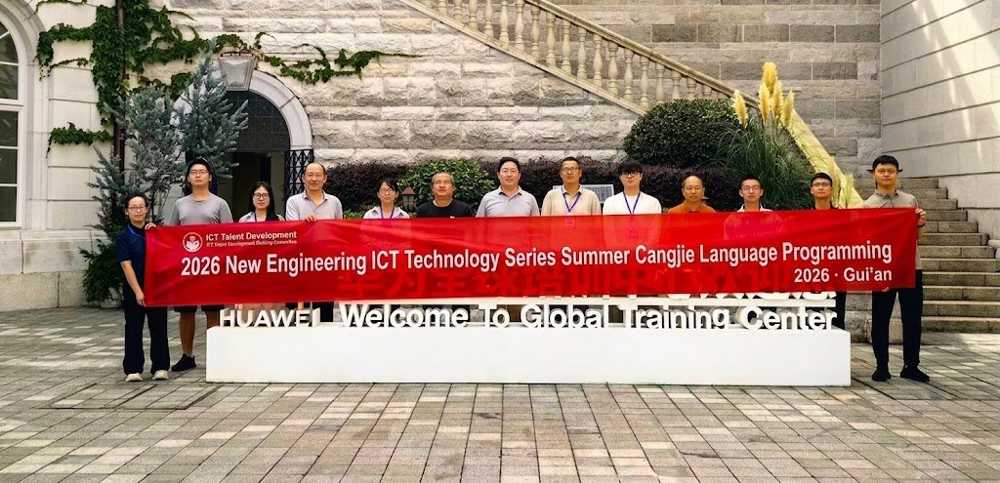

# Grading Students Who Use AI: Notes from a Cangjie Faculty Training

Twelve university lecturers spent three days learning a programming language none of them had taught before. A large share of that time went to a different question: how do you assess a student who is allowed to use AI?

That was the shape of the Cangjie Programming Language module of the 2026 New Engineering ICT summer faculty training, co-hosted by Xi'an Jiaotong University, one of China's leading engineering universities, and Huawei, and held at Huawei's Yunshangtun campus in Gui'an, Guizhou. New Engineering is a Chinese Ministry of Education programme aimed at rebuilding engineering curricula around emerging technology. This session was aimed squarely at people who teach: 12 lecturers from 11 institutions, most of them frontline teaching staff rather than researchers.

## Three days, five units

The course opened with a framing session from the instructor, Xie Tao, on Cangjie as Huawei's general-purpose language for its full device stack, built around native security, efficient concurrency and coverage across scenarios, and on where it currently stands in HarmonyOS native application development.

Then the units.

Unit 1, environment setup and a first look at AI coding: installing and configuring the Cangjie SDK, the IDE and the AI coding assistant, then running Hello Cangjie.

Units 2 and 3, core syntax and advanced features: data types, control flow, functional programming, object orientation, generics and error handling, landing on an AI-assisted refactoring exercise.

Unit 4, HarmonyOS application development in Cangjie: declarative UI and state management, building a to-do app.

Final unit, a capstone and course design session built around a campus course assistant, covering MVVM architecture and data persistence.

Five units, 15 class hours, a rough 3:5:2 split across lecture, hands-on work and discussion, with five lab cases that build on each other. Each teacher left with three things: a running application, a course plan they can deliver at their own institution, and a certificate.

## AI in the room from day one

The AI coding assistant was in the material from the first session rather than demonstrated at the end. Teachers used it for algorithm exercises, debugging and refactoring, working through the full loop of generating code from natural language, having the tool read a whole project for context, and using it for debugging and code review. The lab manual marks the points in each exercise where reaching for AI makes sense.

The stated position was that AI is an accelerator and not a replacement, and that teaching students to use it well matters more than teaching syntax. The discussion sessions treated that as a problem rather than a slogan. Two of the set topics were how to evaluate the quality of AI-generated code, and where the useful boundary of AI tools sits inside a classroom. The direction of travel was to move assessment away from recalling code and toward analysing and solving problems, on the assumption that student AI use is now the normal case rather than the exception.

## Every teacher leaves with a course

Unlike training aimed at students, the target here was the syllabus. Before certification, each participant produced a personal course design for Cangjie Language Programming, covering teaching outline, class hour allocation and lab schedule, then refined it through peer review. The organisers also supplied a 48-hour undergraduate course design case, a teaching resource list and an FAQ, so a teacher going back to their own department starts from working material rather than notes.

The discussion sessions ran on three topics: programming education in the AI era, building HarmonyOS and Cangjie courses with industry input, and cross-institution collaboration, which in practice means lecturers at different schools sharing lab materials and course plans instead of each writing their own. The recurring theme was opening new courses in a domestic language and rebuilding old ones with AI tools.

Yu Yongjun of Guangzhou College of Commerce, one of the participants, said the three days ran from environment setup through to Cangjie HarmonyOS development without skipping steps, and that the sessions on how to reform teaching methods and assessment under AI coding gave him a new way into the problem.

## Why the instructor's own numbers matter

Xie Tao is an associate professor in the School of Computer Science and Technology at Xi'an Jiaotong University, a national first prize winner in the teaching track of the 10th Huawei ICT Competition in 2026, and part of the first cohort of Huawei evangelists and Huawei Developer Experts. He leads the Cangjie Language Programming course at XJTU, which opens to students this autumn with more than 130 already enrolled.

That last figure is the interesting one. Adoption statistics tell you a language is being used. A course opening with 130 registrations tells you a lecturer rewrote their lab materials, retrained themselves, and staked a semester of student outcomes on the choice. Twelve more teachers now hold the materials to make the same bet, and a second training cohort is planned for the fourth quarter of 2026.
