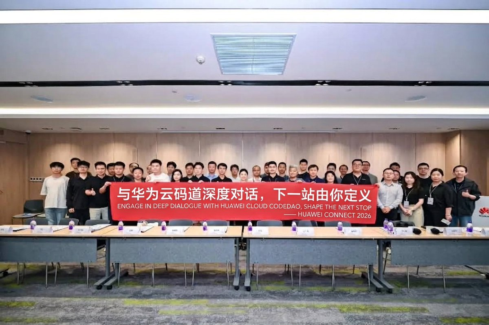
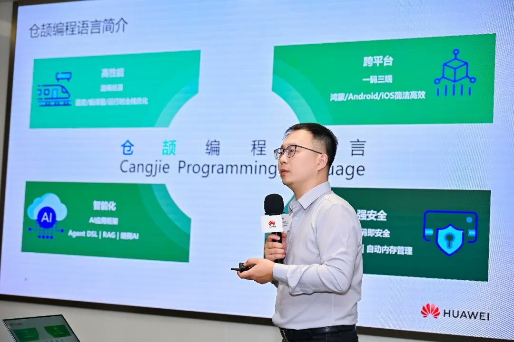
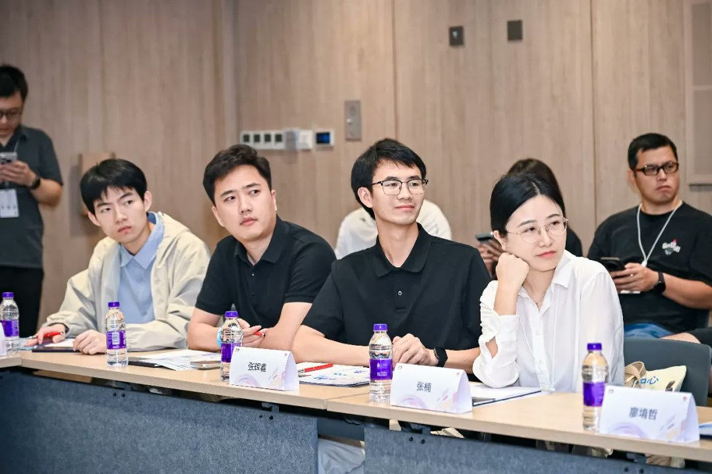

# HUAWEI CONNECT 2026: Putting AI Coding Agents into Real Engineering

Most AI coding demos start from an empty repository. Most real engineering work starts from ten million lines of someone else's code.

That gap framed a Huawei Cloud roundtable on 19 September at HUAWEI CONNECT 2026, the company's annual flagship technology conference.

Where AI coding still breaks down

AI coding has moved beyond autocomplete to multiple agents that split a task, write the code and run the tests together. The organisers named five places where industry adoption still stalls:

1. Understanding existing codebases of tens of millions of lines.
1. Decomposing complex tasks reliably.
1. Turning one engineer's AI habits into something the whole team can reuse.
1. Missing native AI tooling for newer in-house technology stacks.
1. Enterprise demands for data security and control over agent behaviour.

What CodeArts is built for

CodeArts, Huawei Cloud's AI coding agent, is positioned as a code agent that understands engineering practice. It targets four scenarios: incremental development on existing codebases, app development for HarmonyOS (Huawei's operating system for phones and other devices), agentic DevOps, and enterprise-grade security and compliance. The stated aim is what Huawei Cloud calls an "agent engineer" model of development.

Five talks

Ming Liang, Head of Developer Development and Support at Huawei Cloud, opened with the test he said he has applied since taking over the developer business at the start of the year: does a product actually fit into how developers ship work and carry a real project, or does it only look good in a demo? He set out three commitments: joint development and testing on real projects, turning those projects into reusable case studies, and continuing to work with participants after each event. He named three priority areas: university developers, the HarmonyOS development experience, and enterprise agent adoption. Huawei Cloud will put tokens, compute, vouchers and dedicated teams behind joint work with developers, and he described developer feedback as the main input for making the product competitive.

Wang Yinan, CodeArts product expert, gave a product update under the theme "AI coding that gets real work done." CodeArts is concentrating on two directions: incremental development on existing codebases, and HarmonyOS development. By strengthening code comprehension and enforcing a standard development process, he said, CodeArts gets tasks right on the first pass on the same underlying model, and reaches 100% branch coverage in unit tests. For HarmonyOS, it integrates the native toolchain and a knowledge base, which lets it resolve compilation errors with no human intervention. Deeper integration with the wider CodeArts toolchain is under way, along with further work on enterprise compliance and sandboxing.

Liu Xuedong, product planning expert for Huawei Cloud AI Developer Space, presented the platform as a cloud environment where natural language drives the whole development workflow. His summary: instead of developers going looking for tools, the tools come to them. Developer Space comes preloaded with CodeArts, deepseek harness and other agents and tools, both Huawei-built and open source, plus more than 100 Huawei Cloud skill plugins. Developers can bring in open-source or personal projects, use compatible open-source AI tools, and draw on a large token allowance. The intended use is a zero-barrier environment for experimenting with multi-agent development, in university teaching and in enterprise training.

Liao Yuzhe, developer planning expert at Huawei Cloud, introduced Grape, an open-source project aimed at two costs of AI coding in practice: the expense of long agent conversations, and the difficulty of turning individual productivity into team capability. Grape converts any Git project into a cloud-hosted AI workflow in one step and keeps the resulting development assets for the team to reuse, so a proven practice can be tried out at essentially no cost.

Wang Xuezhi, Director of Cangjie Ecosystem and Industry Development, covered the language side. Cangjie is now used in more than 500 HarmonyOS apps and in commercial deployments across more than 20 key industries. In 2026 the project released an AI technology stack for the language, with an agent framework and a skill library connected directly to CodeArts, and several applications have already shipped on it.

This speaks to the fourth sticking point above. A new programming language starts at a disadvantage in the AI era: general-purpose models have seen comparatively little code written in it, so off-the-shelf assistants tend to handle it poorly. That is why a language team would build its own agent framework and skill library rather than rely on general-purpose models alone.

What developers asked for

Speakers and attendees agreed on one premise: agent tools should evolve from what developers actually need. Discussion covered legacy system modernisation, security controls, built-in HarmonyOS knowledge bases, Skill sharing, the full path from development to deployment, and feature parity across platforms.

**The concrete requests:**

1. Smoother installation and better performance across operating systems, with more consistent and stable behaviour on every platform.
1. One-click import of strong Skills from the wider ecosystem, and a jointly built shared Skill library.
1. Encryption and security guarantees when code moves to the cloud.
1. A smoother switch between Agent Team mode and vibe coding.
1. Service management and production deployment inside AI Developer Space.

What comes next

Huawei Cloud's speakers said they would work through the feedback item by item, and connect CodeArts, AI Developer Space, Grape and Cangjie into a single chain spanning tools, language and knowledge base, with support for third-party large models.

The requests are notably practical. Installer friction, cloud encryption and mode switching are what developers run into once the demo is over, which is the same test Ming Liang set in his opening remarks.
