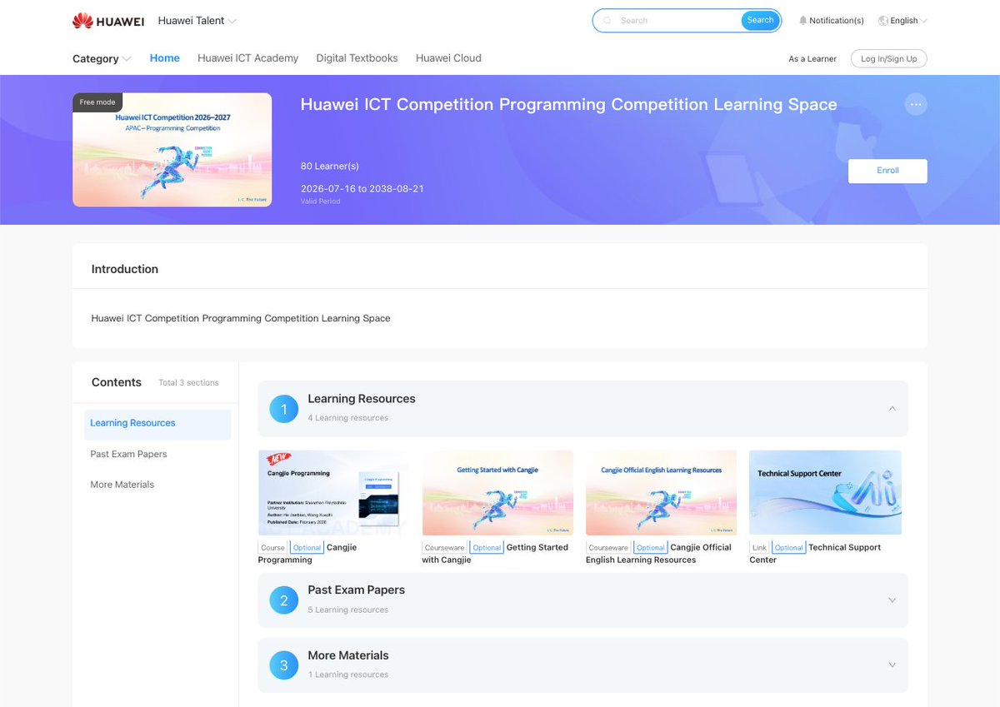
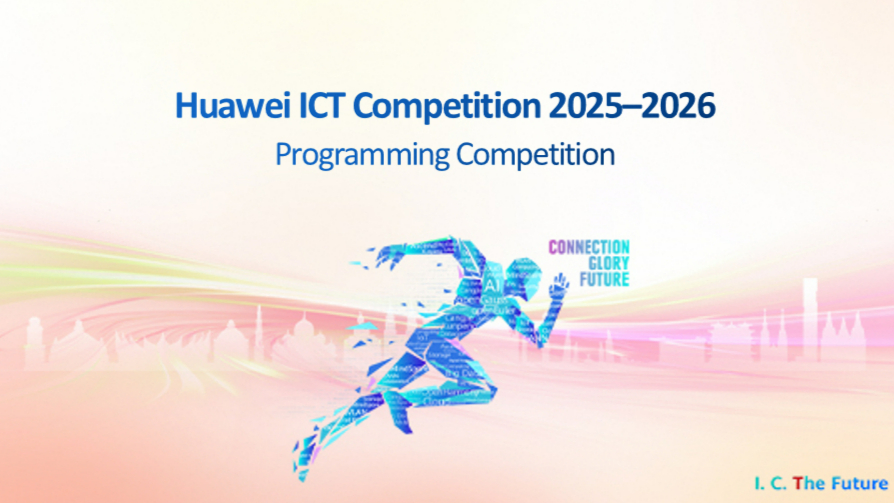

# Huawei ICT Competition Cangjie Track: Your Official Preparation Guide

The Huawei ICT Competition 2026–2027 Programming Competition – Cangjie Track is open to students across the Asia Pacific region for the first time. Here is everything we have prepared to help you study systematically and get ready for the competition.

Official online resources

## Part 1: Learning Space

You can access the Learning Space through the competition registration page. It includes the following.

**01 Learning resources **

- 2 core courses: Cangjie programming basics and advanced practice 
- Official Cangjie language resources 
- Official technical guidance

**02 Past exam papers **

- Previous competition questions with detailed analyses, to help you understand the competition format and key topics.

**03 More materials **

Additional learning materials, tools and references (some in Chinese).

Explore the preparation resources: [[https://talent.shixizhi.huawei.com/h5/weportal/#/mapFreedom/2077652815903506434?sxz-lang=en_US](https://talent.shixizhi.huawei.com/h5/weportal/#/mapFreedom/2077652815903506434?sxz-lang=en_US)]

## Part 2: Two live sessions

Join our experts for an in-depth analysis of competition topics and practical preparation tips.

• Exam Syllabus Interpretation 
14 October, 16:00–17:00 (UTC+8):
[[[https://welink.huaweicloud.com/meeting/#/j/529203307337/9d41fa51535f63879e00e29533f4a5c2dfbab010f37417a5cedc795568b410c5?meetingType=wiseClou](https://welink.huaweicloud.com/meeting/#/j/529203307337/9d41fa51535f63879e00e29533f4a5c2dfbab010f37417a5cedc795568b410c5?meetingType=wiseCloud)d](https://welink.huaweicloud.com/meeting/#/j/529203307337/9d41fa51535f63879e00e29533f4a5c2dfbab010f37417a5cedc795568b410c5?meetingType=wiseCloud)] 

• Cangjie Language Tutoring
21 October, 16:00–17:00 (UTC+8): 
[Link TBD]

**Recommended preparation path**

1. Learn the Cangjie basics
1. Practise with the official resources
1. Review past competition questions and analyses
1. Join the competition

Register for the Cangjie Track here: [[[https://e.huawei.com/en/talent/#/ict/innovation-details?zoneCode=050133&zoneId=98269685&compId=85132020&divisionName=Asia%20Pacifi](https://e.huawei.com/en/talent/#/ict/innovation-details?zoneCode=050133&zoneId=98269685&compId=85132020&divisionName=Asia%20Pacific)c](https://e.huawei.com/en/talent/#/ict/innovation-details?zoneCode=050133&zoneId=98269685&compId=85132020&divisionName=Asia%20Pacific)]

We look forward to seeing you in the competition.
