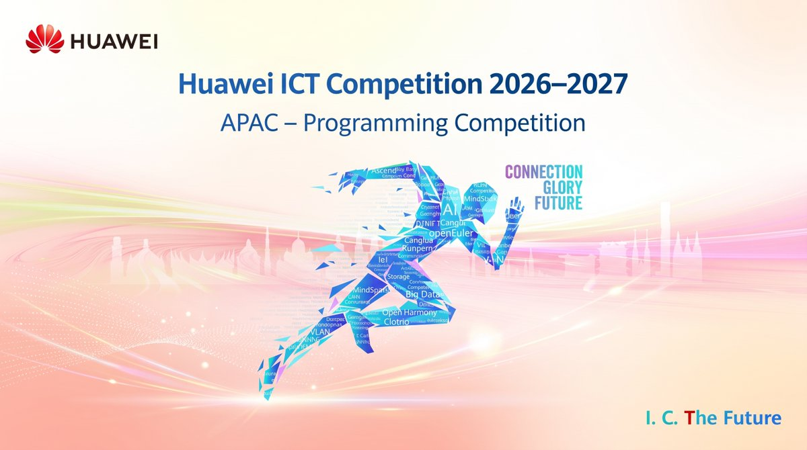

# Huawei ICT Competition: A Q&A on the New Cangjie Track

For the first time, the Huawei ICT Competition's Programming Competition is running a Cangjie track for students across the Asia Pacific region. You don't need any prior Cangjie experience to enter, and registration is open until November 10, 2026.

The Huawei ICT Competition is Huawei's annual technology competition for university students worldwide. Below are answers to the questions students have asked most about the Cangjie track.

Key dates

Registration deadline: November 10, 2026

National Competition online exam: November 17, 2026 (exact time to be announced)

What is Cangjie?

Cangjie is a new-generation programming language from Huawei, designed for full-scenario application development. It supports multiple programming paradigms and is built to be efficient, secure and easy to use.

A common question is whether it is a front-end or back-end language. It isn't limited to either: Cangjie is used for back-end services, system software, AI applications and more.

How the competition works

There are three rounds:

1. National Competition: students register and compete individually.
1. Regional Competition (Asia Pacific): qualifiers compete in teams of three students and one instructor.
1. Global Final: teams compete for the overall title.

You don't need a team to sign up. Everyone enters the National Competition as an individual, and the organizing committee will coordinate team formation for those who qualify for the Regional Competition. For now, the focus is simply on doing well in the first round.

The National Competition exam

The exam is an individual online test taken on Shixizhi, Huawei's online learning platform, using your own computer and your registration account. There is nothing to install yet: a test link will be shared before the exam, and the pre-exam notice will set out the device and software requirements.

The exam consists of hands-on programming tasks only. There are no true or false, multiple-choice or fill-in-the-blank questions. The number of tasks will be confirmed in the exam notice.

How to prepare

The competition learning space includes courses, official Cangjie technical resources and past exam papers with full analysis. Since the exam is entirely practical coding, the past papers are the best guide to what to expect.

Start with "Answers and Explanations for the Programming Competition Exam Questions for the Huawei ICT Competition 2025–2026" in the Past Exam Paper section.

Register

Registration for the Cangjie track closes on November 10, 2026, one week before the National Competition exam on November 17.

Link:
[https://e.huawei.com/en/talent/#/ict/innovation-details?zoneCode=050133&zoneId=98269685&compId=85132020&divisionName=Asia%20Pacific](https://e.huawei.com/en/talent/#/ict/innovation-details?zoneCode=050133&zoneId=98269685&compId=85132020&divisionName=Asia%20Pacific)

