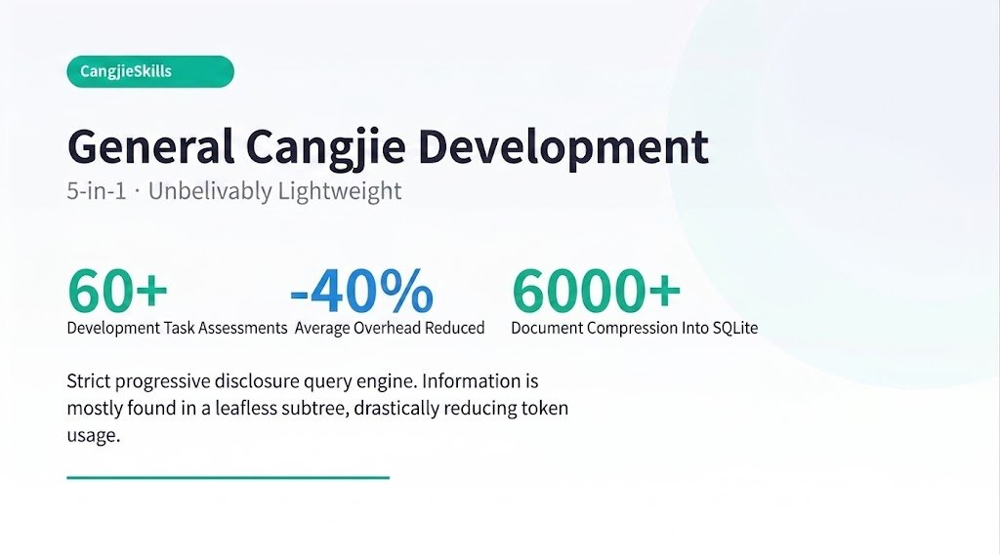
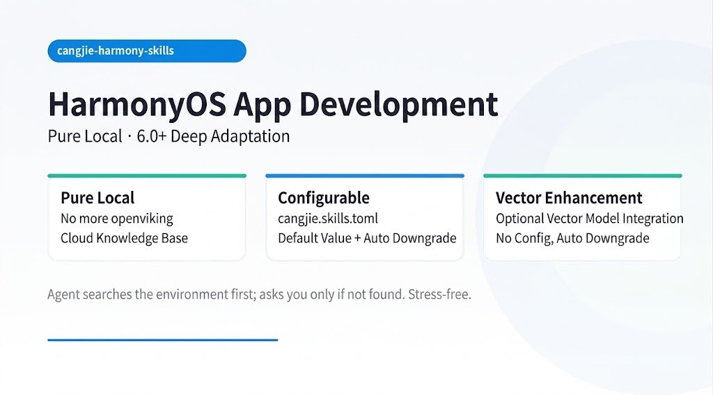
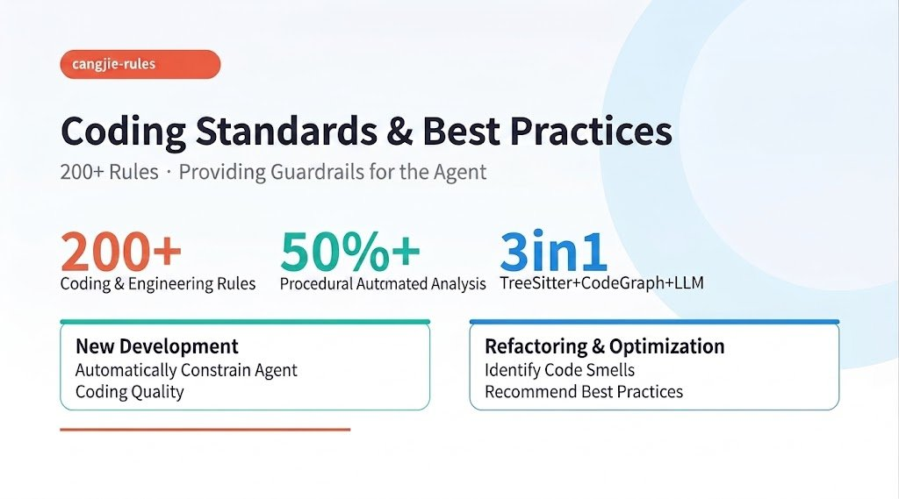

# New Agent Skills for Cangjie: General Dev, HarmonyOS, and 200+ Rules

Merging five agent skills into one cut average overhead by 40 percent across more than 60 development tasks.

That result comes from CangjieSkills, one of three new Agent Skills released by community contributors working on Cangjie, Huawei's programming language for the HarmonyOS ecosystem. Between them they cover general development, HarmonyOS app development, and coding standards.

## 1. CangjieSkills, general development

The previous generation shipped as five separate skills. They are now one, and the consolidation made agent runs cheaper rather than heavier.

The reason is the retrieval layer: a knowledge base and query engine built on strict progressive disclosure. Most queries resolve on a subtree without ever reaching a leaf, so the agent takes what it needs and stops there. Token usage drops accordingly. Branches and leaves together run past 6,000 documents, and the release build compresses all of them into a single SQLite database, which keeps the published skill light enough to pull in on demand.

[https://gitcode.com/Cangjie-SIG/CangjieSkills](https://gitcode.com/Cangjie-SIG/CangjieSkills)

## 2. cangjie-harmony-skills, HarmonyOS app development

The old HarmonyOS knowledge base required a self-hosted cloud deployment (openviking). The replacement is fully local and works out of the box, with deep coverage of HarmonyOS 6.0 and above. You can optionally point it at an embedding model for stronger retrieval, and if you skip that step it falls back automatically instead of breaking.

The whole set now reads its configuration from cangjie.skills.toml. Environment parameters that used to be hard-coded have defaults and a fallback path, and you can override them yourself. The agent probes its own environment first and only comes back to you when the probe fails.

[https://github.com/SunriseSummer/cangjie-harmony-skills](https://github.com/SunriseSummer/cangjie-harmony-skills)

[https://gitcode.com/Cangjie-SIG/CangjieSkills/tree/harmonyos-6.1](https://gitcode.com/Cangjie-SIG/CangjieSkills/tree/harmonyos-6.1)

## 3. cangjie-rules, coding standards and best practices

Built on TreeSitter, CodeGraph and an LLM, it enforces more than 200 Cangjie coding and engineering rules. Over half are checked programmatically and the rest go to the model, which is the honest split: a parser catches what a parser can catch, and judgment calls escalate. It runs in both directions, constraining agent-written code as it is produced and flagging smells in existing code during refactoring.

[https://github.com/SunriseSummer/cangjie-rules](https://github.com/SunriseSummer/cangjie-rules)

The common thread across all three is that the hard problem in agent tooling right now is not what you tell the agent, it is what the agent has to load before it can be useful. A 6,000 document knowledge base that fits in one file, a local index in place of a hosted service, and a rules engine that only reaches for the model when static analysis runs out. Three different ways of not spending context.

