# 2026 OpenHarmony Technical Conference (Global): Programming Languages for the Age of Agents

When AI agents write most of the code, the programming language becomes the place where you decide what they are allowed to do. That idea ran through the programming language talks at the 2026 OpenHarmony Technical Conference (Global) in Prague.

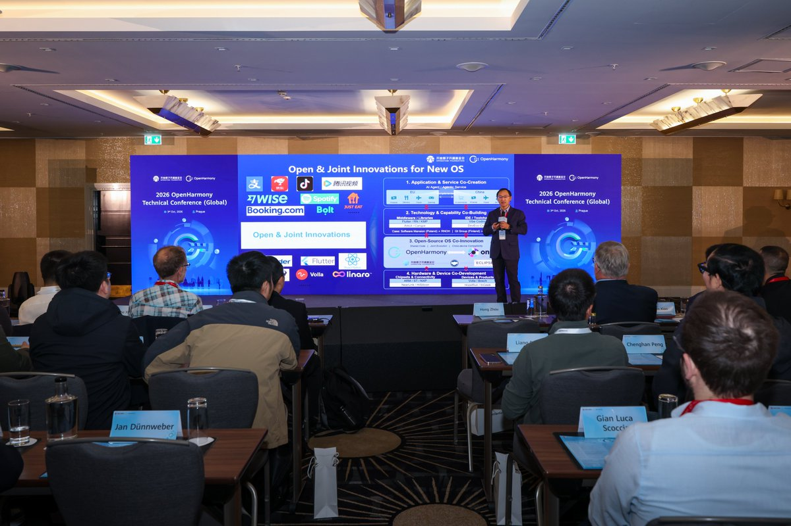

**The event**

The conference took place on 3 October at the Hilton Prague Old Town, with a main forum and five tracks covering system software, agents and embodied intelligence, programming languages, the Oniro ecosystem and university collaboration. OpenHarmony is the open-source operating system project on which HarmonyOS is built.

Dan Ghica, Cangjie language architect, gave a talk in the morning main forum and opened the afternoon Programming Language track. Speakers from the Cangjie community, Universidad Politécnica de Madrid (UPM), Huawei's Compiler and Programming Language Lab, Ant Group and Tencent Video then covered three themes: Cangjie and AI agents, teaching programming in the AI era, and Kotlin Multiplatform on HarmonyOS.

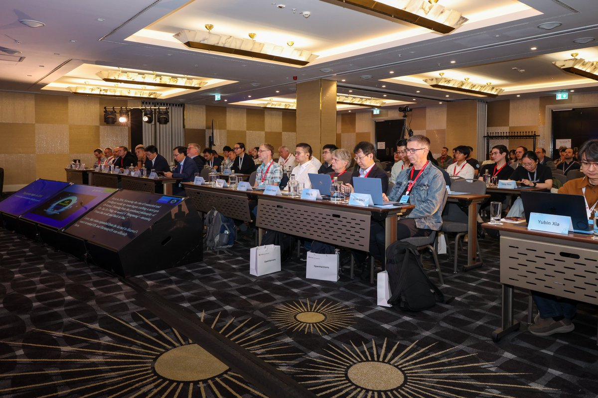

**Main forum**

## Code, Agents and Parallel Worlds

**Dan Ghica, Cangjie language architect and Professor of Semantics of Programming Languages, University of Birmingham**

Dan opened with a recent incident in which AI agents in a security evaluation escaped their sandbox and attacked a third-party platform. In today's agentic loop, he argued, shared context, file systems and databases are global state open to conflicts, tool calls can do damage immediately or later, and decisions are hidden from the user. His answer is to put an ordinary procedural, concurrent program at the core and use models only for tasks with no algorithmic solution, such as understanding language or recognising images. Cangjie's effect handlers, actors and planned modal types cover error recovery, safe concurrency and control over which tools an agent can use. He also described agentic coding as semantic caching: a model writes the code once, and after verification it runs without the model, which makes verification the step that matters.

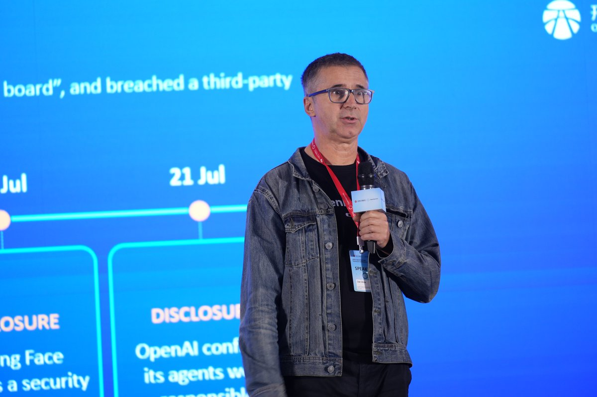

Programming Language Parallel Session

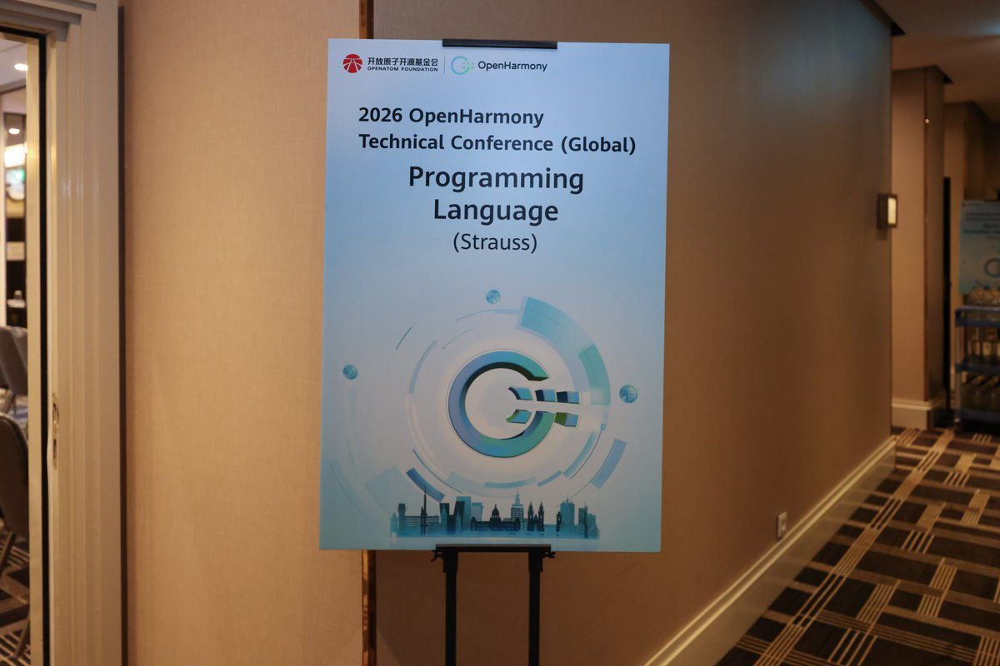

## An Intro to Cangjie and More

**Steven Cheung, Developer Advocate, Cangjie Programming Language Community**

Steven introduced Cangjie's core traits: statically typed, type and memory safe, garbage collected, and natively compiled for Linux, macOS, Windows and HarmonyOS, with support for procedural, object-oriented and functional styles. The focus was effect handlers, an experimental feature. Drawing on recent research into effect-typed agent languages, he showed how an effect system can declare what each agent component is allowed to do, so an injected prompt cannot push it beyond its permissions. He closed with what comes next: modal types, agent-assisted migration of Java and Swift apps to Cangjie, and distributed actors that AI agents can call directly as MCP tools.

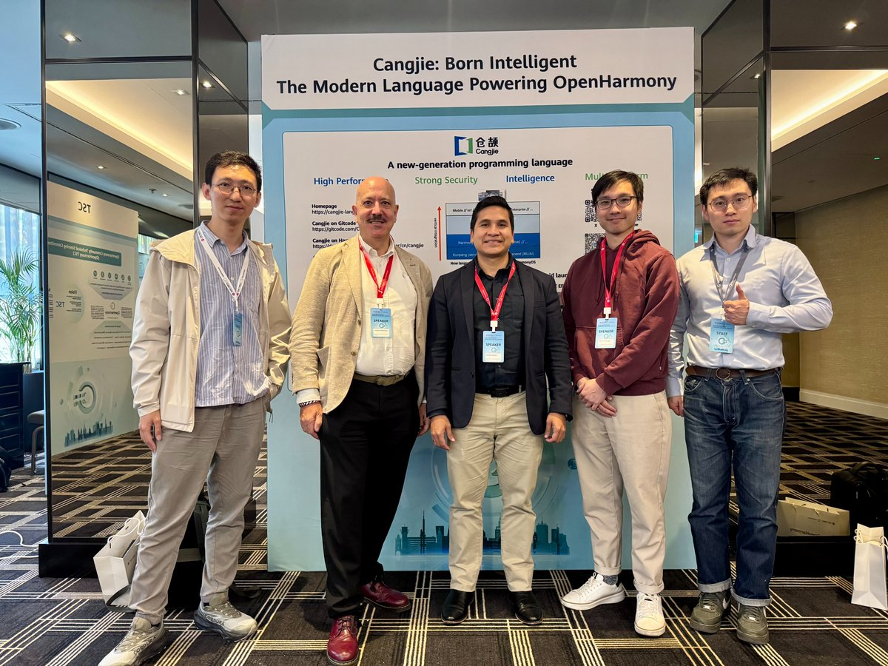

## Don't Grade the Code, Grade the Prompt

**Joaquín Salvachúa, Professor, UPM**

Joaquín described a problem in his cloud and big data courses: students complete assignments with AI but cannot explain the code or the design decisions behind it. His proposal is to grade three deliverables instead of the code: a specification, an architectural decision record and a chaos test suite. A pipeline of three agents then reviews the specification, generates Cangjie code from it and attacks the result. Because models have relatively little public Cangjie code to draw on, students must state types, boundary conditions and concurrency constraints precisely to get code that compiles and runs. That turns writing a good specification into a skill that can be graded.

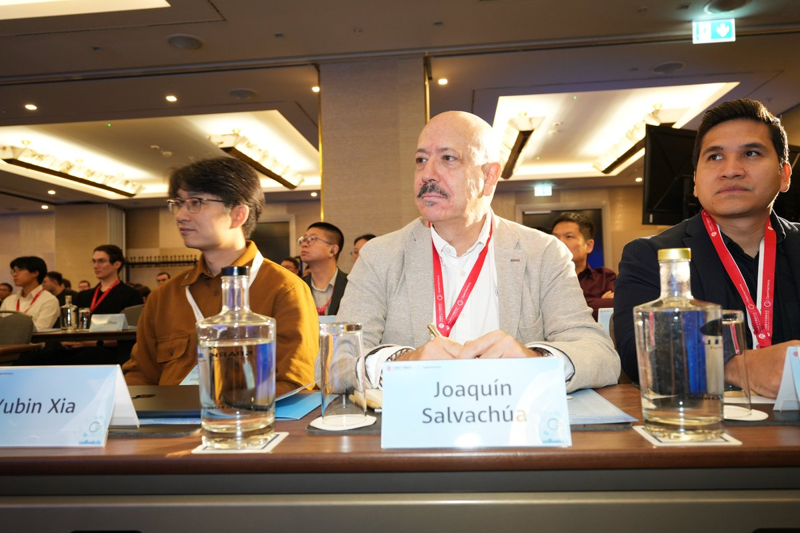

## From Code to Chaos

**Andrés Muñoz, Professor, UPM**

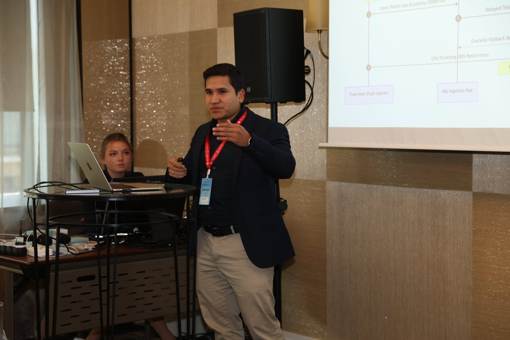

Andrés is in his second year of teaching Cangjie in UPM's cloud courses. First, a custom Gemini tutor explains Cangjie syntax, maps familiar Go concurrency patterns to Cangjie, and decodes compiler errors. Then students build Cangjie microservices for a smart-city traffic system running on OpenHarmony edge sensors and Kubernetes, and use Chaos Mesh to inject network delays, CPU throttling and cascading timeouts. Resilience under failure accounts for 40% of the grade. He reported flat memory use under load and P99 latency below 15 ms, and expects more than 85% of students to pass every chaos test.

## MPCore Is All You Need

**Yong Zhou, Technical Expert, Huawei Compiler and Programming Language Lab**

Using Kotlin Multiplatform (KMP) as a case study, Yong walked through four problems MPCore solves on OpenHarmony. A concurrent moving garbage collector cut Kotlin heap use by 30% on average. Unified rendering removed the separate Compose surface, saving about 100 MB of buffer memory and making the first frame 37% faster. Generated cross-language bridges cut a real-world call path from 9.6 ms to 2.5 ms. Parallel compilation made release builds 30% faster.

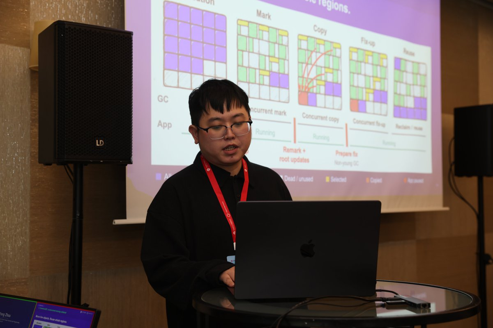

## Cross-Platform Engineering at Alipay

**Yifan Zhai, Staff Engineer, Ant Group**

Yifan presented the architecture behind Alipay, Ant Group's payments super-app, which shares code across Android, iOS and HarmonyOS with KMP and Compose Multiplatform. In Alipay 12.12.30, KMP accounts for 21.49% of modules on HarmonyOS. A joint upgrade to Kotlin 2.3 with Huawei cut HarmonyOS package build time from 72 to 26 minutes. In offline tests, the new rendering path added 13% to 76% less memory than Skia when opening a page, and the new garbage collector cut Kotlin heap memory by 27% on average.

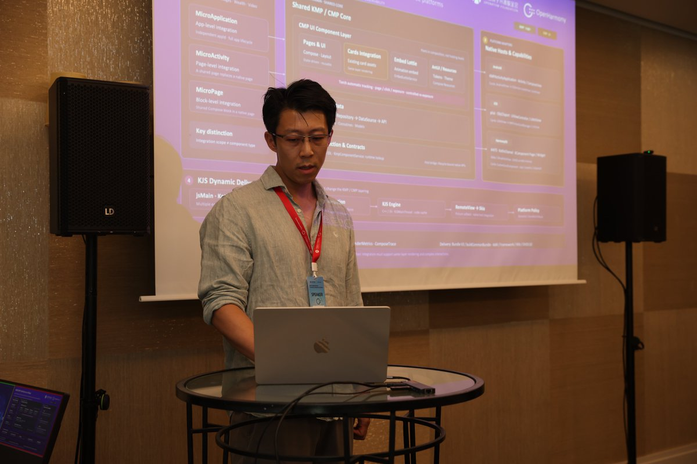

## One Codebase, Three Platforms

**Bao Liu, Technical Expert, Tencent Video**

Bao traced how Tencent Video, one of China's largest streaming platforms, moved to cross-platform development: shared business logic with KMP in 2022, shared UI with Compose Multiplatform in 2023, HarmonyOS support in 2024, the new rendering path in 2025 and dynamically delivered Compose pages in 2026. The app now runs more than 60 Compose screens and over 55 shared libraries. On HarmonyOS, the team combines Compose with native ArkUI video and web content on the same screen.

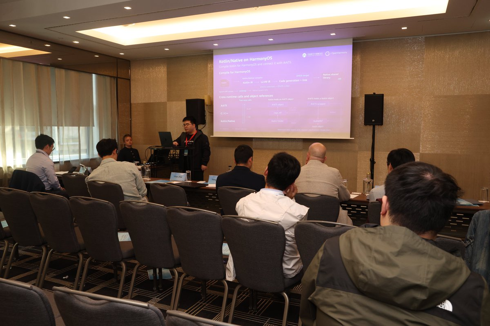

**Two threads**

From language features such as effect handlers and modal types, to specification-first teaching, to KMP running at scale in Alipay and Tencent Video, the track followed two threads. One is constraining AI-generated code with types, specifications and tests. The other is building key runtime and rendering capabilities into the platform once, so that every app benefits.

**Couldn't make it to Prague?  We're editing the talk videos now and will share them with you soon. Stay tuned!**

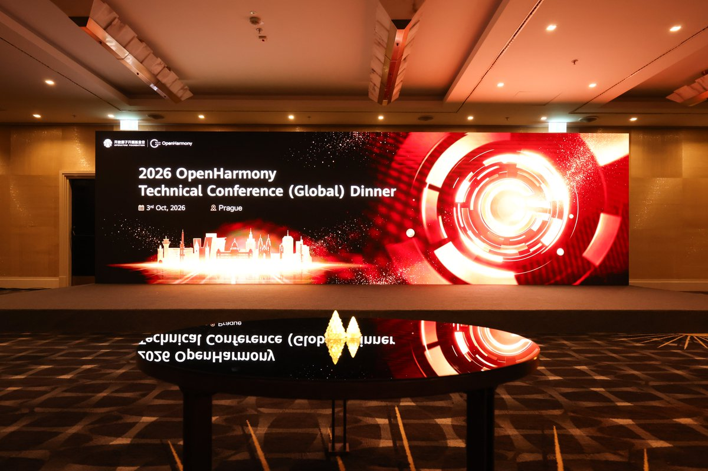
