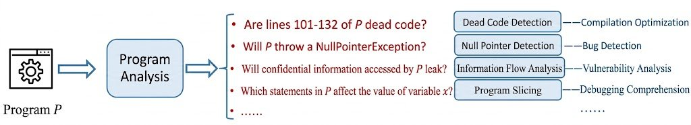
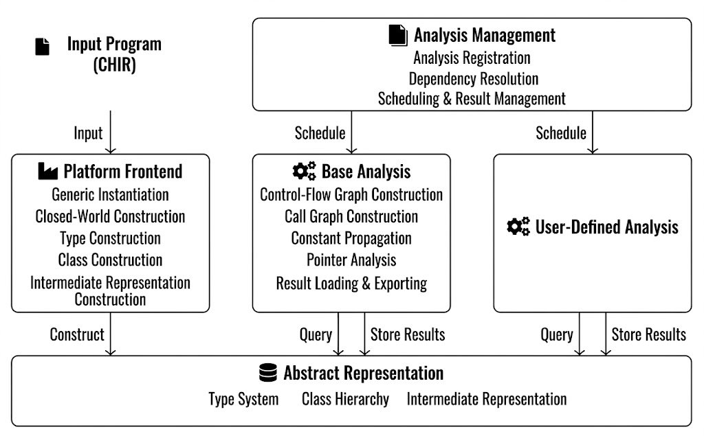
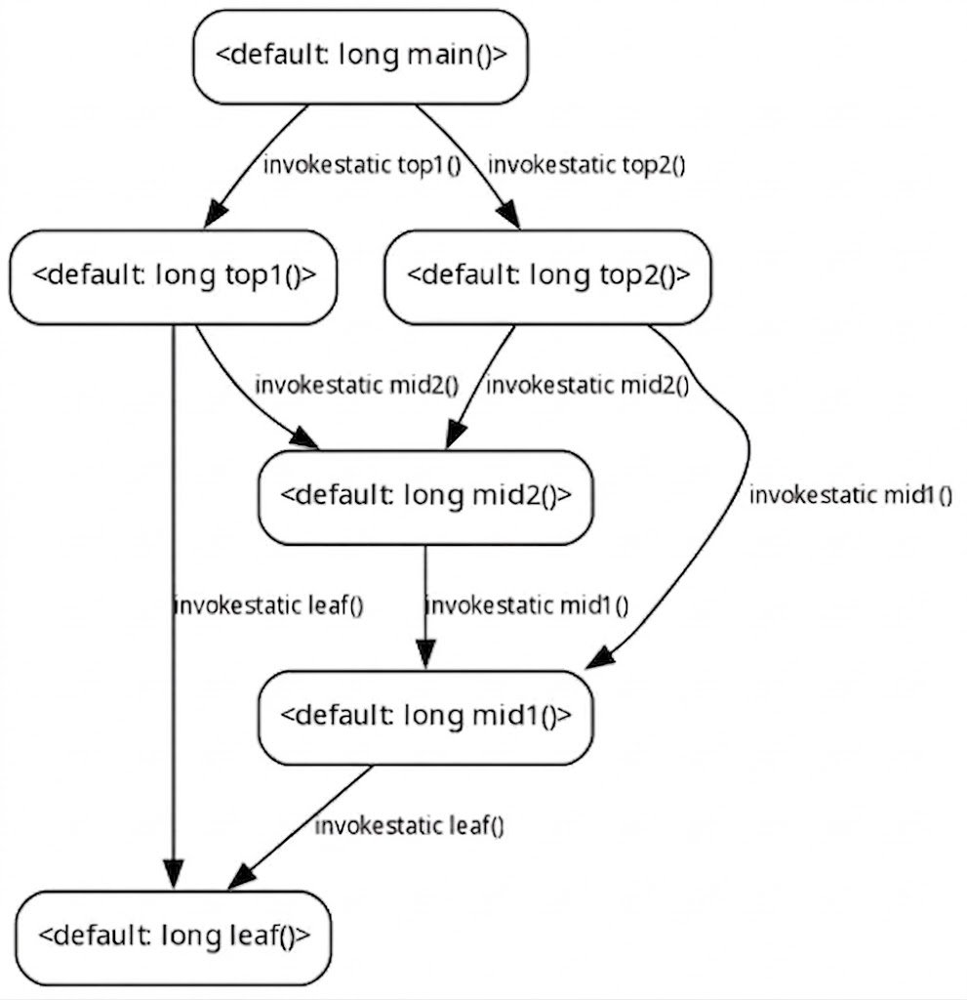

# Tai-e-Cangjie Open Sources Cangjie's First Static Analysis Platform

A static analysis framework built for Java assumes things Cangjie doesn't do: objects always live on the heap, references get passed around freely, generics disappear after compilation, classes are closed to extension once defined. Cangjie works the opposite way on every one of those points, which is what made building a static analysis platform for it a real engineering problem rather than a straightforward port.

On September 1, Nanjing University's Software Institute (a leading Chinese CS research institute) open sourced Tai-e-Cangjie, the first general-purpose static analysis platform for Cangjie, built by extending the team's existing Java framework Tai-e. The first public release, v1.2-cj1.0.5, targets Cangjie 1.0.5 and ships under LGPLv3.

## Background: Cangjie's Missing Toolchain Foundation

Static analysis is baseline toolchain infrastructure. Almost every established language has mature tooling for it: finding dead code, catching null pointer risks, running security audits, understanding what a piece of code actually does at runtime. Cangjie, as a newer language, has had none of this. Developers needing analysis tools were building them from source code, one problem at a time, with no shared foundation underneath.



## Core Work: Porting Tai-e to Cangjie

Tai-e-Cangjie is not a simple port. Tai-e's intermediate representation is built on JVM assumptions: objects are heap-allocated, references pass by reference, generics are erased at compile time, classes can't be extended after the fact. Cangjie has value semantics, generics that get instantiated at runtime, type extension, algebraic data types (enums), and first-class functions, all of which conflict directly with what Tai-e assumed.

The team's frontend takes Cangjie's own high-level intermediate representation (CHIR) as input, about 24,000 lines of dedicated translation code converting CHIR into Tai-e's intermediate representation (TIR), while keeping TIR extensions minimal to preserve compatibility with the existing Java-side analyses. 



Five features absorbed most of the engineering effort:

1. Value semantics: composite types are modeled uniformly as reference types, with a cloning strategy restoring value-copy behavior where it matters.
1. Generic instantiation: every concrete type that appears at runtime gets its own class abstraction, with the class hierarchy kept in sync.
1. Type extension: constrained extensions are statically woven into their target classes under a closed-world assumption.
1. Enums: modeled as an enum interface with constructor classes implementing it, an inheritance-style pattern.
1. First-class functions: new intermediate representation statements handle the creation and dynamic invocation of function objects and closures.

Because the frontend stays close to Tai-e's original model, most existing Java analyses work without modification. Pointer analysis needed the most rework, since value semantics and first-class functions touch it directly. To validate the translation itself, the team built a TIR interpreter that runs the translated code and compares its behavior against the static analysis results, checking both translation correctness and pointer analysis soundness.

## Capability: Ready to Use, Built to Extend

The platform works both as a ready-to-use tool and as a framework to build on. Built in: control-flow and data-flow analysis (control-flow graphs, interprocedural graphs, standard dataflow analyses), pointer analysis (whole-program analysis and call graph construction, with a choice of context-sensitivity settings), common analyses (dead code, null pointer, invalid type casts, polymorphic call sites), extension interfaces for writing new analyses at function, class, package, or whole-program granularity, and supporting tools for exporting intermediate representations and results, plus interpreter-based validation. Developers can write new analyses, adapt existing ones, or reuse analyses originally built for the Java version of Tai-e.

## Validation: Tested Against Real Code

The team ran three rounds of testing. Language feature coverage: 28 test suites and 133 assertion points spanning value semantics, generics, type extension, enums, and first-class functions, all verified correct through the interpreter. Pointer analysis reliability: 24 traditional-feature suites plus 28 Cangjie-specific ones, run across four context-sensitivity settings (context-insensitive, 2-call-site-sensitive, 3-object-sensitive, 4-type-sensitive), producing 208 analysis results that all passed interpreter-based soundness checks.

For real-world performance, they ran pointer analysis on 15 third-party open-source libraries spanning networking, messaging, databases, security, image processing, data parsing, infrastructure, scientific computing, and reactive programming, with codebases from a few thousand to tens of thousands of lines. Frontend translation finished within 15 seconds for all of them (intermediate representation construction took under 2 seconds), and pointer analysis across the four context-sensitivity settings averaged 1 to 7.6 seconds, topping out around 18.6 seconds. Developers can trade precision for speed depending on what they need.

## Usage and Documentation

The platform runs on Java 17 or newer. The workflow: generate CHIR with cjc --save-temps, then invoke the analysis from the command line. Full documentation in English and Chinese, plus Javadoc API references, covers configuration and extension in more detail.



A small example shows the basic flow. A five-function Cangjie program (leaf, mid1, mid2, top1, top2, called from main) compiles to CHIR with:

```text
cjc --save-temps chir main.cj
```

Then Tai-e-Cangjie builds the call graph:

```text
java -jar tai-e-all-v1.2-cj1.0.5.jar -pkg <stdlib CHIR dir> -apkg chir -m default -a "cg=dump:true"
```

-pkg points at the CHIR for dependencies, including the Cangjie standard library, which any analysis needs. -apkg points at the application's own CHIR. -m default names the package containing main. -a "cg=dump:true" runs call graph construction and writes the result as a DOT file, showing every method reachable from main.

Tai-e-Cangjie is on GitCode at Tai-e-Cangjie/Tai-e-Cangjie, licensed LGPLv3 like the Java version. The current release targets Cangjie's LTS branch at 1.0.5; other Cangjie versions haven't been systematically tested against it.

What's notable here isn't the feature list so much as the constraint the team worked under: keep TIR extensions minimal enough that the platform stays two things at once, a Cangjie-native analysis tool and a place where the existing body of Java-side static analysis work stays reusable.
