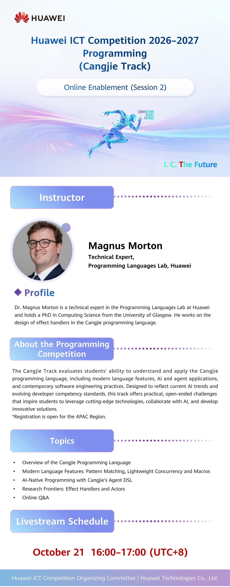

# Cangjie Track Enablement Session 2: Language and Agent DSL

📢APAC Region: Get Ready for the Huawei ICT Competition 2026-2027 Programming Competition (Cangjie Track)!

Join Session 2 of our online enablement series for a deep dive into the Cangjie language, from modern language features and AI-native programming with Agent DSL to the latest research frontiers.

Instructor: Dr. Magnus Morton, Technical Expert, Programming Languages Lab, Huawei
📅 October 21 | 16:00–17:00 (UTC+8)
A must-attend session for students aiming to excel in the competition.

🔗 Click to watch live:
[https://welink.huaweicloud.com/meeting/?fbclid=IwY2xjawVCuhtleHRuA2FlbQIxMABwZG9mBWJyaWQRMHhWRG1tTE9ObFVsM29weHhzcnRjBmFwcF9pZBAyMjIwMzkxNzg4MjAwODkyAAEe-AsIIJNvIDUDVLVNtOBm-6jLkx_g-hasO2OOOogY4EFYttk2XvEXfUi4fSY_aem_9N-SAl4Kc3jn1N0SKYLV7Q#/m/540360361921/175dd166086a5c710c482e69e6a662b75591002667f323f1c96ebff6ef2b54e3?meetingType=wiseCloud](https://welink.huaweicloud.com/meeting/?fbclid=IwY2xjawVCuhtleHRuA2FlbQIxMABwZG9mBWJyaWQRMHhWRG1tTE9ObFVsM29weHhzcnRjBmFwcF9pZBAyMjIwMzkxNzg4MjAwODkyAAEe-AsIIJNvIDUDVLVNtOBm-6jLkx_g-hasO2OOOogY4EFYttk2XvEXfUi4fSY_aem_9N-SAl4Kc3jn1N0SKYLV7Q#/m/540360361921/175dd166086a5c710c482e69e6a662b75591002667f323f1c96ebff6ef2b54e3?meetingType=wiseCloud)
🔗 Competition Registration: [https://e.huawei.com/en/talent/#/ict/innovation-details?zoneCode=050133&zoneId=98269685&compId=85132020&divisionName=Asia%20Pacific](https://e.huawei.com/en/talent/#/ict/innovation-details?zoneCode=050133&zoneId=98269685&compId=85132020&divisionName=Asia%20Pacific)
#APAC #ICTCompetition #ProgrammingCompetition

