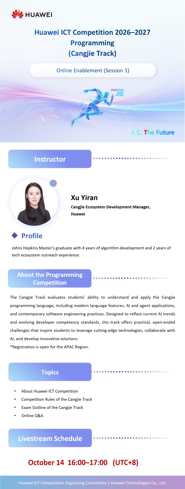

# Cangjie Track Online Enablement Session: Rules, Exam Outline, and Q&A

📢APAC Region: Get Ready for the Huawei ICT Competition 2026-2027 Programming Competition (Cangjie Track)!

Join our online enablement session to get all the key information you need about the Cangjie Track, from competition rules and exam outline to a live Q&A.

Instructor: Xu Yiran, Cangjie Ecosystem Development Manager, Huawei
📅 October 14 | 16:00–17:00 (UTC+8)
This track tests your skills in modern language features, AI and agent applications, and cutting-edge software engineering.

🔗 Click to watch live: [https://welink.huaweicloud.com/meeting/#/j/529203307337/9d41fa51535f63879e00e29533f4a5c2dfbab010f37417a5cedc795568b410c5?meetingType=wiseCloud](https://welink.huaweicloud.com/meeting/#/j/529203307337/9d41fa51535f63879e00e29533f4a5c2dfbab010f37417a5cedc795568b410c5?meetingType=wiseCloud)

🔗 Register here for the competition:
[https://e.huawei.com/en/talent/#/ict/innovation-details?zoneCode=050133&zoneId=98269685&compId=85132020&divisionName=Asia%20Pacific](https://e.huawei.com/en/talent/#/ict/innovation-details?zoneCode=050133&zoneId=98269685&compId=85132020&divisionName=Asia%20Pacific)

