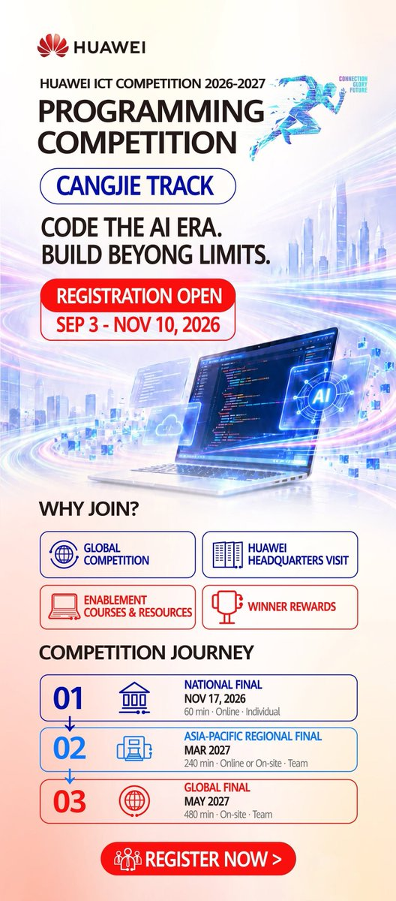

# Huawei ICT Competition Cangjie Track Opens Across Asia Pacific

Ready to take your coding further? 📷 For the first time, the Huawei ICT Competition's Programming Competition is open for registration across the Asia Pacific! Join the Cangjie Track, challenge yourself, and compete for a spot in the regional and global finals. You'll also earn competition rewards and a chance to visit Huawei headquarters.

Register by November 10, 2026. Code for the AI era. Build without limits. 📷

#HuaweiICTCompetition #ProgrammingCompetition #Cangjie

