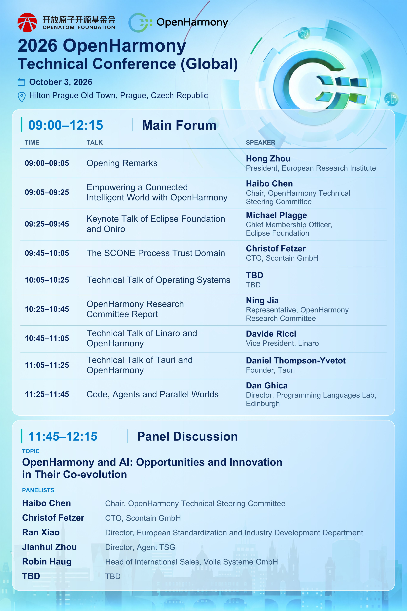

# OpenHarmony Technical Conference (Global): Main Forum Lineup

OpenHarmony Technical Conference (Global) | Prague, 3 Oct 2026

Main Forum lineup: Eclipse Foundation, Linaro, Tauri, Scontain, Dan Ghica on "Code, Agents and Parallel Worlds", and a panel on OpenHarmony and AI.

Free registration: [https://www.eventbrite.com/e/openharmony-technical-conferenceglobal-tickets-1997946773583](https://www.eventbrite.com/e/openharmony-technical-conferenceglobal-tickets-1997946773583)
#OpenHarmony #Cangjie

