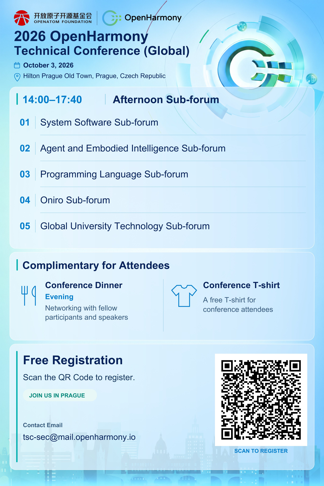

# OpenHarmony Technical Conference (Global): Five Sub-Forums

5 sub-forums at #OpenHarmony Technical Conference (Global), Prague, 3 Oct:

Programming Language 👈 Cangjie is here
System Software
Agent & Embodied Intelligence
Oniro
Global University Technology

Free registration, dinner and T-shirt 👉 [https://www.eventbrite.com/e/openharmony-technical-conferenceglobal-tickets-1997946773583](https://www.eventbrite.com/e/openharmony-technical-conferenceglobal-tickets-1997946773583)
#Cangjie

